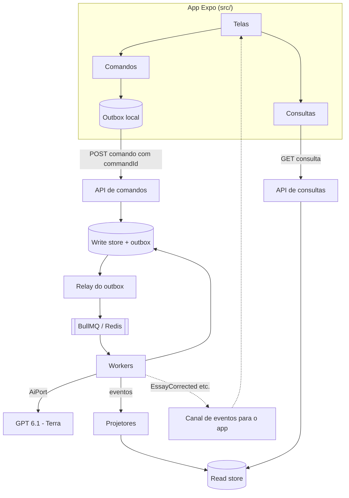
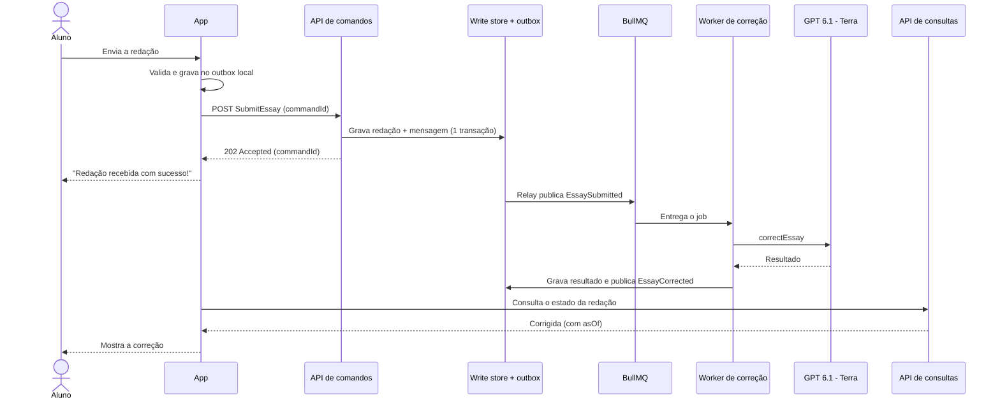

# Arquitetura do Aprova.AI — EDA + CQRS

Este documento é a fonte de verdade da arquitetura do Aprova.AI e das regras de organização de diretórios. `docs/ARQUITETURA.pdf` é gerado a partir dele e deve ser regenerado a cada alteração (ver [§13](#13-governança-dos-documentos)).

O Aprova.AI é um aplicativo para Android e iOS, feito com Expo e TypeScript, para estudo para o Enem, a Fuvest e outros vestibulares, com correção e apoio por IA (GPT 6.1 - Terra).

## Sumário

1. [Objetivo e escopo](#1-objetivo-e-escopo)
2. [Decisões arquiteturais](#2-decisões-arquiteturais)
3. [Visão geral](#3-visão-geral)
4. [CQRS: comandos e consultas](#4-cqrs-comandos-e-consultas)
5. [EDA: eventos](#5-eda-eventos)
6. [Mensageria: BullMQ + Redis](#6-mensageria-bullmq--redis)
7. [Workers e integração com a IA](#7-workers-e-integração-com-a-ia)
8. [Fluxos principais](#8-fluxos-principais)
9. [Aplicativo móvel](#9-aplicativo-móvel)
10. [Organização de diretórios](#10-organização-de-diretórios)
11. [Resiliência e segurança](#11-resiliência-e-segurança)
12. [Testes e validação](#12-testes-e-validação)
13. [Governança dos documentos](#13-governança-dos-documentos)
14. [Decisões em aberto](#14-decisões-em-aberto)

## 1. Objetivo e escopo

O objetivo é garantir que o app não trave e que nenhuma atividade em segundo plano se perca. Para isso, o que o aluno faz na tela (comandos) é desacoplado do que o sistema processa nos bastidores (consultas e IA).

Este documento define:

- a arquitetura geral (Event-Driven Architecture + CQRS) e seus contratos de alto nível;
- as regras de organização de diretórios e a refatoração aplicada ao repositório;
- as decisões em aberto que dependem de aprovação (§14).

Este documento não implementa funcionalidades, não adiciona dependências e não define autenticação, banco de dados, provedor de notificações nem a rubrica de correção de redações.

**Estado de partida (verificado em `package.json` e no código):** Expo `~57.0.24`, React Native `0.86.3`, React `19.2.3` e TypeScript `~6.0.3` em modo estrito. Não há roteador, cliente de rede, persistência, gerenciador de estado nem scripts de lint, testes ou verificação de tipos. O código existente é uma tela vazia em `src/app/App.tsx`.

## 2. Decisões arquiteturais

| Id | Decisão | Motivo |
| --- | --- | --- |
| D1 | Arquitetura geral: EDA + CQRS. | Isolar a interação do aluno do processamento pesado e escalar leitura e escrita de forma independente. |
| D2 | Fila padrão: BullMQ + Redis. SQS e RabbitMQ são alternativas atrás de uma porta única (`QueuePort`). | Backend em Node/TypeScript, com retries, backoff, jobs atrasados e limite de taxa para a IA, e pouca operação inicial. |
| D3 | Comandos respondem de imediato (`202 Accepted`); o trabalho pesado roda em Workers. | Evita timeout da API e mantém o app responsivo (“Redação recebida com sucesso!”). |
| D4 | O app mantém um outbox local e envia cada comando com chave de idempotência. | Nenhum comando se perde offline ou em falha de rede, e reenvios não duplicam efeitos. |
| D5 | O servidor grava o estado e a mensagem de saída na mesma transação (outbox transacional) e um relay publica na fila. | Evita o estado inconsistente “gravou mas não enfileirou”. |
| D6 | A IA só é chamada por Workers, atrás de `AiPort`. | Isola timeout, custo, limite de taxa e troca de provedor ou de modelo. |
| D7 | Repositório único: app Expo na raiz, `backend/` e `contracts/`, sem workspaces nesta fase. | Evita mover o Expo e reconfigurar Metro, `app.json` e `tsconfig` antes de existir código de backend com dependências próprias. |
| D8 | O lado de leitura é eventualmente consistente; a interface mostra estados explícitos de recebido, em processamento, concluído e falha. | A projeção é assíncrona; o aluno nunca vê um estado ambíguo. |

Alternativas consideradas para D7: monorepo com `apps/mobile`, `apps/api` e `apps/worker` (adiado: exige mover o Expo e alterar configuração de pacotes) e repositório separado para o backend (adiado: dificulta compartilhar `contracts/` e revisar mudanças de contrato em um único lugar). A migração para workspaces é compatível com esta estrutura.

## 3. Visão geral



- Lado de escrita: `UI → Comandos → Outbox local → API de comandos → Write store`.
- Lado de processamento: `Write store → Relay → BullMQ → Workers → IA / Projetores`.
- Lado de leitura: `UI → Consultas → API de consultas → Read store`.
- O canal de eventos para o app (push, polling ou SSE) está em aberto (§14); a arquitetura exige apenas que ele entregue eventos do §5.

## 4. CQRS: comandos e consultas

| Conceito | Comando | Consulta | Evento |
| --- | --- | --- | --- |
| Significado | Intenção de mudar o estado. | Pedido de leitura. | Fato já ocorrido. |
| Nome | Verbo no imperativo: `SubmitEssay`. | `Get` + objeto: `GetPerformanceSummary`. | Passado: `EssaySubmitted`. |
| Efeito | Muda estado. | Nunca muda estado. | Imutável. |
| Resposta | `202 Accepted` com `commandId`; nunca o resultado do processamento. | DTO de um modelo de leitura. | Não há resposta. |
| Local | `application/commands` | `application/queries` | `application/events` |

### Lado de escrita

- Todo comando carrega `commandId` (UUID gerado no cliente), `issuedAt` (ISO 8601 UTC) e o `payload`. O `commandId` é a chave de idempotência: reenviar o mesmo comando devolve a mesma resposta e não repete o efeito.
- O handler valida o comando na borda, aplica as regras de `domain/`, grava o novo estado e a mensagem de saída na mesma transação e responde `202`.
- O write store é otimizado para gravações rápidas: inserções e atualizações simples, sem joins de leitura. A tecnologia está em aberto (§14).

### Lado de leitura

- Consultas leem apenas modelos de leitura (projeções) desnormalizados e otimizados para leitura massiva: estatísticas de desempenho, gráficos de evolução e histórico de simulados.
- Toda resposta de consulta carrega `asOf` (instante da última projeção aplicada). A interface usa esse valor para indicar que o dado pode estar atrasado, em vez de apresentá-lo como definitivo.
- Handlers de consulta não importam `domain/` nem o write store.

### Sincronização

Projetores (`application/events`) consomem eventos pela fila `projections`, atualizam o read store e registram a versão do agregado aplicada. Um evento com `aggregateVersion` menor ou igual ao já aplicado é ignorado, o que torna a projeção idempotente e tolerante a reentrega.

## 5. EDA: eventos

### Envelope

| Campo | Descrição |
| --- | --- |
| `eventId` | UUID único; chave de idempotência dos consumidores. |
| `type` | Nome do evento, no passado (`EssaySubmitted`). |
| `version` | Versão do esquema do evento. |
| `occurredAt` | Instante do fato, em ISO 8601 UTC. |
| `aggregateId` e `aggregateVersion` | Agregado de origem e sua versão após o fato. |
| `correlationId` | `commandId` que originou a cadeia de eventos. |
| `causationId` | Id da mensagem que causou este evento. |
| `payload` | Dados do fato. |

### Garantias

- Entrega pelo menos uma vez (at-least-once): todo consumidor é idempotente por `eventId`.
- A ordem só é garantida por agregado, e é verificada pela versão do agregado (§4), não pela fila.
- Esquemas de evento só mudam de forma compatível; uma mudança incompatível cria uma nova `version`.

### Catálogo inicial

O catálogo deriva dos fluxos descritos no pedido de arquitetura. Um evento novo só existe depois de entrar nesta tabela.

| Evento | Produzido por | Consumido por |
| --- | --- | --- |
| `QuestionAnswered` | Comando `AnswerQuestion` | Projetor de desempenho |
| `RoutineProgressRecorded` | Comando `RecordRoutineProgress` | Projetor de rotina e de desempenho |
| `EssaySubmitted` | Comando `SubmitEssay` | Worker `essay-correction` |
| `EssayCorrected` | Worker `essay-correction` | Projetor de redações e canal de eventos do app |
| `EssayCorrectionFailed` | Worker `essay-correction` | Projetor de redações e canal de eventos do app |
| `MockExamCompleted` | Comando `CompleteMockExam` | Worker `mock-exam-processing` |
| `MockExamProcessed` | Worker `mock-exam-processing` | Projetor de desempenho e canal de eventos do app |

Os comandos acima formam o conjunto inicial: `AnswerQuestion`, `RecordRoutineProgress`, `SubmitEssay` e `CompleteMockExam`. As consultas iniciais são as de leitura de desempenho, evolução, histórico de simulados e estado/resultado de uma redação. Seus campos serão definidos em `contracts/` com aprovação.

## 6. Mensageria: BullMQ + Redis

### Filas

| Fila | Conteúdo | Consumidor |
| --- | --- | --- |
| `essay-correction` | Correção de redações pela IA. | `backend/src/workers/essay-correction` |
| `mock-exam-processing` | Processamento de simulados concluídos. | `backend/src/workers/mock-exam-processing` |
| `projections` | Eventos que atualizam modelos de leitura. | `backend/src/workers/projections` |
| `dead-letter` | Mensagens que esgotaram as tentativas ou falharam de forma permanente. | Reprocesso manual e alerta |

Nomes de fila usam kebab-case. Uma fila nova entra nesta tabela antes de existir no código.

### Contrato do job

- `name`: tipo do comando ou do evento; `data`: envelope do §5.
- `jobId` determinístico (`<type>_<aggregateId>_<commandId>`), que faz o BullMQ ignorar a publicação duplicada enquanto o job existir.
- O `jobId` não basta para idempotência, porque jobs concluídos podem ser removidos. Cada consumidor registra os `eventId` já processados no banco, na mesma transação do efeito.

### Tentativas, falhas e limites

- Falhas transitórias (timeout, `429`, `5xx` da IA, indisponibilidade de banco): nova tentativa com backoff exponencial. O número de tentativas e o atraso inicial são configuração do Worker; os valores iniciais serão definidos na implementação e confirmados por teste de carga.
- Falhas permanentes (payload inválido, conteúdo rejeitado, saída da IA fora do esquema depois das tentativas): o Worker sinaliza falha não recuperável, publica o evento `...Failed` e copia a mensagem para `dead-letter` com o contexto do erro.
- A cópia para `dead-letter` é um passo explícito do tratamento de falha final do Worker; não depende de recurso específico da versão do BullMQ.
- `concurrency` e `limiter` por Worker respeitam o limite de taxa e o custo do provedor de IA.
- Jobs travados (stalled) são reentregues pelo BullMQ; por isso todo handler é idempotente.

### Durabilidade do Redis

- Instância dedicada ao BullMQ, com persistência AOF habilitada e política de memória `noeviction`.
- Mesmo com perda de dados no Redis, o outbox transacional (D5) republica o que não foi concluído.

### Observabilidade

- Todo log e job carrega `correlationId` (`commandId`).
- Métricas mínimas por fila: profundidade, idade do job mais antigo, latência de processamento e taxa de falha. O alerta mais importante é o crescimento de `dead-letter`.

### Porta única

`application/ports` define `QueuePort` (publicar e consumir mensagens do §5). O adaptador BullMQ fica em `infrastructure/queue`. SQS (com SNS para fan-out) e RabbitMQ são implementações alternativas da mesma porta; trocar de tecnologia não altera `domain/` nem `application/`.

## 7. Workers e integração com a IA

- Um Worker é um processo separado, sem servidor HTTP, que consome uma fila. Escala horizontalmente e tem `concurrency` própria.
- Workers são montados nas composition roots de `backend/src/bootstrap`, que ligam portas a adaptadores.

### Pipeline de correção de redação

1. O Worker consome `EssaySubmitted` e carrega a redação.
2. Chama `AiPort.correctEssay`, com tempo limite próprio.
3. Valida a saída da IA contra o esquema antes de persistir qualquer resultado.
4. Grava o resultado e publica `EssayCorrected` (ou `EssayCorrectionFailed`).
5. O projetor atualiza o read store e o canal de eventos avisa o app.

### Regras para a IA

- O modelo informado é GPT 6.1 - Terra. O identificador exato do provedor é configuração do servidor e deve ser confirmado antes da implementação (§14).
- A chave de API existe só no servidor, fora do repositório, e nunca no app.
- Prompts são versionados em `backend/src/infrastructure/ai/prompts`; o resultado registra `promptVersion` e o modelo usado, para auditoria.
- A interface nunca mostra a saída bruta da IA nem detalhes de erro do provedor; em falha, mostra uma mensagem compreensível e a ação de recuperação.
- O texto do aluno só trafega do servidor para o provedor, com o mínimo de dados necessário.

## 8. Fluxos principais

### 8.1 Envio de redação



### 8.2 Conclusão de simulado longo

Mesmo padrão do §8.1, com o comando `CompleteMockExam`, a fila `mock-exam-processing` e os eventos `MockExamCompleted` e `MockExamProcessed`. O app responde na hora com a confirmação de recebimento; o desempenho consolidado aparece quando a projeção é aplicada.

### 8.3 Resposta de questão e progresso da rotina

Comandos `AnswerQuestion` e `RecordRoutineProgress` seguem o fluxo de escrita rápida: gravação no write store, `202` imediato e atualização das estatísticas pela fila `projections`. Não há chamada de IA.

### 8.4 Consulta de estatísticas

A consulta vai direto à API de consultas e lê o read store. Não passa por comando, fila nem Worker. A resposta traz `asOf`.

## 9. Aplicativo móvel

### Camadas do cliente

`ui` → `commands` e `queries` → `core`. A interface nunca chama a rede diretamente: comandos passam pelo outbox e consultas pelo cliente de `core/api`.

### Outbox local

- Todo comando é gravado no outbox local antes do envio e só sai de lá quando a API responde `202`.
- Sem conexão, o comando permanece pendente e é reenviado com o mesmo `commandId`.
- O mecanismo de persistência local depende de dependência a aprovar (§14).

### Estados de um comando na interface

| Estado | Significado | Texto e ação de recuperação |
| --- | --- | --- |
| `queued-locally` | Gravado no outbox, ainda não enviado. | Informar que será enviado quando houver conexão. |
| `sending` | Envio em andamento. | Indicador de carregamento; sem ação duplicada. |
| `received` | A API respondeu `202`. | Confirmação de recebimento (por exemplo, “Redação recebida com sucesso!”). |
| `processing` | Worker em execução. | Informar que o processamento está em andamento. |
| `completed` | Evento de conclusão aplicado na projeção. | Mostrar o resultado. |
| `failed` | Evento `...Failed` ou rejeição permanente. | Mensagem compreensível e ação de reenviar. |

- Todo estado é comunicado por texto, nunca só por cor ou ícone, e mudanças relevantes são anunciadas por tecnologia assistiva.
- Consultas guardam o `asOf` da resposta e são invalidadas quando chega um evento relacionado; se o canal de eventos estiver indisponível, usam polling com intervalo crescente.

## 10. Organização de diretórios

### 10.1 Estrutura alvo

```text
Aprova.AI/
├── index.ts                    # Entrada do Expo (registerRootComponent); é o `main` do package.json
├── app.json
├── package.json
├── tsconfig.json
├── assets/                     # Ícones e imagens
├── contracts/                  # Contrato app <-> backend: tipos, sem lógica
│   ├── commands/               # *.command.ts
│   ├── queries/                # *.query.ts (pedido e DTO de resposta)
│   └── events/                 # *.event.ts e envelope
├── src/                        # Aplicativo móvel (Expo)
│   ├── app/                    # Composição: App.tsx, providers, navegação
│   ├── features/<contexto>/    # questions, routine, mock-exams, essay, performance
│   │   ├── commands/           # Intenções do aluno -> outbox -> API de comandos
│   │   ├── queries/            # Leituras: hooks e mapeadores de DTO
│   │   ├── events/             # Reação a eventos recebidos
│   │   └── ui/                 # Telas e componentes exclusivos do contexto
│   ├── core/                   # Infraestrutura do cliente, sem regra de negócio
│   │   ├── api/                # Cliente HTTP de comandos e consultas
│   │   ├── outbox/             # Fila local de comandos pendentes
│   │   ├── storage/            # Persistência local
│   │   └── events/             # Canal de eventos do servidor
│   ├── components/             # UI compartilhada (*.web.tsx ao lado do nativo)
│   ├── hooks/                  # Hooks compartilhados
│   └── constants/              # Tokens visuais (theme.ts)
├── backend/                    # API de comandos e consultas + Workers
│   └── src/
│       ├── domain/             # Agregados, eventos de domínio e regras (puro)
│       ├── application/
│       │   ├── commands/       # Handlers de comando
│       │   ├── queries/        # Handlers de consulta
│       │   ├── events/         # Projetores e reações a eventos
│       │   └── ports/          # QueuePort, AiPort, repositórios, relógio
│       ├── infrastructure/
│       │   ├── queue/          # Adaptador BullMQ (e alternativas)
│       │   ├── persistence/    # Write store, read store e outbox
│       │   └── ai/             # Adaptador GPT 6.1 - Terra e prompts versionados
│       ├── api/                # HTTP: rotas de comando e rotas de consulta, separadas
│       ├── workers/            # Um processador BullMQ por fila
│       └── bootstrap/          # Composition roots: api.ts e worker.ts
├── docs/                       # Documentação (ARQUITETURA.md e .pdf, guias, design)
├── .claude/ e .agents/         # Regras e workflows para assistência ao desenvolvimento
└── README.md
```

Contextos iniciais de `features/` (glossário português → pasta): questões → `questions`, rotina → `routine`, simulados → `mock-exams`, redação → `essay`, desempenho → `performance`. Um contexto novo só nasce com um comando, uma consulta ou uma tela real.

### 10.2 O que existe e o que nasce no primeiro uso

Para não criar pastas vazias nem abstrações sem uso, o repositório contém hoje apenas as camadas, cada uma com um `README.md` de uma página (responsabilidade e limites de importação). Subpastas e arquivos de código surgem junto com o primeiro uso real:

| Já existe | Nasce no primeiro uso |
| --- | --- |
| `index.ts`, `src/app/` | `src/components/`, `src/hooks/`, `src/constants/theme.ts` |
| `contracts/`, `src/features/`, `src/core/` (README) | Subpastas de `contracts/`, de `src/core/` e de cada contexto |
| `backend/src/domain`, `application`, `infrastructure`, `api`, `workers`, `bootstrap` (README) | Subpastas de `application/` e `infrastructure/`, `backend/package.json` |

### 10.3 Regras de dependência

| Camada | Pode importar | Não pode importar |
| --- | --- | --- |
| `src/app` | `features/*`, `core`, `components`, `hooks`, `constants` | — |
| `src/features/<contexto>` | `core`, `components`, `hooks`, `constants`, `contracts` | Outro contexto; `app` |
| `src/core` | `contracts` | `features`, `app`, `components` |
| `src/components` | `hooks`, `constants` | `features`, `core`, `app` |
| `src/hooks`, `src/constants` | `constants` | `features`, `core`, `app`, `components` |
| `contracts` | Apenas arquivos de `contracts` | `src`, `backend` |
| `backend/domain` | Nada além de si | Todo o restante |
| `backend/application` | `domain`, `contracts` | `infrastructure`, `api`, `workers`, bibliotecas de fila, IA ou banco |
| `backend/infrastructure` | `application/ports`, `domain`, `contracts` | `api`, `workers` |
| `backend/api` | `application`, `contracts` | `infrastructure`, `domain` |
| `backend/workers` | `application`, `contracts` | `infrastructure`, `api` |
| `backend/bootstrap` | Todas as camadas | — |

Contextos do app se comunicam por eventos e contratos, nunca importando uns aos outros. Handlers de consulta só leem o read store; handlers de comando só gravam no write store e no outbox.

### 10.4 Convenções

- Pastas em kebab-case; um arquivo, uma responsabilidade.
- Sufixos por papel: `*.command.ts`, `*.query.ts`, `*.event.ts`, `*.handler.ts`, `*.projector.ts`, `*.worker.ts`, `*.port.ts`, `*.adapter.ts`.
- Tipos ficam junto do único consumidor. Um tipo usado pelo app e pelo backend vai para `contracts/` (a segunda utilização real).
- `contracts/` só tem tipos e constantes. Esquemas de validação em tempo de execução entram quando a dependência de validação for aprovada (§14).
- Arquivos específicos de plataforma (`*.web.tsx`) ficam ao lado do arquivo nativo.
- Não há barramento genérico de comandos ou consultas: rotas e telas chamam o handler diretamente. Um barramento só entra quando houver necessidade real (por exemplo, middleware comum).
- O alias `@/` (para `src/`) e quaisquer outros aliases entram no `tsconfig.json` junto do primeiro uso; hoje não há aliases configurados.
- Enquanto o Expo Router não for aprovado, `src/app/` contém a composição do app. Se for aprovado, esta seção registra para onde a composição migra, porque `src/app/` passa a conter somente rotas.
- Quando `backend/package.json` existir, o `tsconfig.json` da raiz passa a excluir `backend/`, que terá o seu.

### 10.5 Onde colocar cada coisa

| Preciso de… | Local |
| --- | --- |
| Um novo comando do aluno | `contracts/commands` + `src/features/<contexto>/commands` + `backend/src/application/commands` |
| Uma nova leitura ou gráfico | `contracts/queries` + `src/features/<contexto>/queries` + `backend/src/application/queries` |
| Um novo evento | Catálogo do §5, `contracts/events`, produtor e consumidores |
| Uma nova fila ou Worker | Tabela do §6 e `backend/src/workers` |
| Chamar a IA | `AiPort` em `application/ports`; adaptador em `infrastructure/ai` |
| Uma tela de um contexto | `src/features/<contexto>/ui` |
| Um componente usado por vários contextos | `src/components` |

### 10.6 Refatoração aplicada

| Antes | Depois | Motivo |
| --- | --- | --- |
| `src/app/index.ts` | `index.ts` (raiz) | O `package.json` declara `main: "index.ts"`, arquivo que não existia na raiz; mover corrige a entrada e reserva `src/app/` para composição ou rotas. O import passa a `./src/app/App`. |
| `src/app/App.tsx` | Sem mudança | Já está na camada de composição. |
| — | `contracts/`, `src/features/`, `src/core/` com `README.md` | Camadas do cliente e do contrato. |
| — | `backend/src/{domain,application,infrastructure,api,workers,bootstrap}` com `README.md` | Camadas de API e Workers. |

## 11. Resiliência e segurança

Nenhuma atividade em segundo plano se perde porque há cinco proteções em camadas: outbox local, idempotência por `commandId`, outbox transacional, tentativas do BullMQ com Redis persistente e `dead-letter` com reprocesso.

| Cenário | Comportamento |
| --- | --- |
| App sem conexão | O comando fica no outbox local e é reenviado com o mesmo `commandId`. |
| API grava, mas a resposta se perde | O app reenvia; a API reconhece o `commandId` e devolve o mesmo `202`. |
| Redis indisponível | A API continua aceitando comandos (outbox transacional); o relay publica quando o Redis voltar. |
| Relay cai entre gravar e publicar | A mensagem segue pendente no outbox e é publicada depois; uma duplicata é absorvida pela idempotência dos consumidores. |
| Worker cai durante um job | O job travado é reentregue; o handler é idempotente. |
| Timeout ou `429` da IA | Nova tentativa com backoff; `limiter` e `concurrency` reduzem a pressão. |
| Saída da IA fora do esquema | Validação falha; depois das tentativas, falha permanente, `...Failed` e `dead-letter`. |
| Mensagem que sempre falha | Vai para `dead-letter`, gera alerta e aguarda reprocesso manual. |
| Projeção atrasada | A consulta devolve `asOf` antigo e a interface sinaliza o atraso. |

Segurança:

- Segredos e chaves ficam fora do repositório. O `.gitignore` atual cobre `.env*.local`, não `.env`; revise a cobertura antes de introduzir variáveis de ambiente.
- Todo dado é validado na borda: comando, consulta, evento e saída da IA.
- Erros mostrados ao aluno não expõem identificadores, tokens nem payloads de falha.
- A identidade do aluno e a política de dados pessoais (LGPD) estão em aberto (§14); nenhum comando ou consulta é implementado sem definir a quem o dado pertence.

## 12. Testes e validação

- Estado atual: não há executor de testes nem scripts de lint, testes ou verificação de tipos, e nenhuma cobertura pode ser afirmada. A verificação de tipos pode ser feita manualmente com `npx tsc --noEmit`, que não é um script configurado.
- Quando um executor de testes for aprovado: testes unitários de `domain`, handlers e projetores; testes de contrato entre `contracts/` e a API; teste de integração com BullMQ e um Redis efêmero; teste de ponta a ponta do fluxo do §8.1.
- Toda nova fronteira (comando, consulta, evento, saída da IA) é testada nos casos de sucesso, inválido, ausente e falha.

## 13. Governança dos documentos

| Documento | Responsabilidade |
| --- | --- |
| `docs/ARQUITETURA.md` e `docs/ARQUITETURA.pdf` | Arquitetura, decisões, contratos e organização de diretórios. |
| `docs/AGENTS.md` | Regras compartilhadas dos agentes. |
| `docs/Claude.md` e `docs/CLAUDE.local.md` | Guia operacional e preferências locais. |
| `docs/Codex.md` | Resumo para o Codex. |
| `docs/DESIGN.md` e `docs/DesignIA_Regras.md` | Design, interface e checklist contra aparência genérica. |
| `README.md` | Visão geral, comandos e árvore de arquivos. |
| `.claude/` e `.agents/` | Regras, comandos, skills e agentes. |

Ao mudar uma decisão ou a estrutura:

1. Atualize `docs/ARQUITETURA.md`.
2. Atualize a árvore e o estado atual no `README.md`.
3. Atualize os guias (`AGENTS.md`, `Claude.md`, `Codex.md`) e as regras em `.claude/` e `.agents/` que citem o que mudou.
4. Regenere `docs/ARQUITETURA.pdf`.
5. Faça um commit por assunto, no padrão `(tipo): Frase no passado`, como em `(docs): Adicionado README.md completo e estruturado desta fase inicial`.

## 14. Decisões em aberto

Cada item abaixo exige decisão antes de qualquer implementação que dependa dele.

| Decisão | Impacto |
| --- | --- |
| Autenticação e identidade do aluno | Todo comando, consulta e evento precisa pertencer a um aluno. |
| Banco do write store e do read store | Modelagem de agregados, projeções e outbox. |
| Runtime e framework do backend | Estrutura de `backend/package.json` e de `api/`. |
| Hospedagem do Redis e dos Workers | Persistência AOF, alertas e escala. |
| Canal de eventos para o app (push, polling ou SSE) | Como o app descobre `EssayCorrected` e `MockExamProcessed`. |
| Persistência local do app (outbox) | Dependência nova no app. |
| Biblioteca de validação em tempo de execução | Esquemas em `contracts/`. |
| Expo Router e biblioteca de dados do cliente | Onde fica a composição de `src/app/` (§10.4). |
| Contrato exato do GPT 6.1 - Terra (identificador, limites, formato de saída) | `AiPort`, limites de taxa e prompts. |
| Rubrica de correção de redação e regras de simulado | Esquema do resultado da IA e dos eventos. |
| LGPD: base legal, retenção e exclusão | Dados enviados à IA e guardados no servidor. |
| Executor de testes e integração contínua | Seção 12. |
