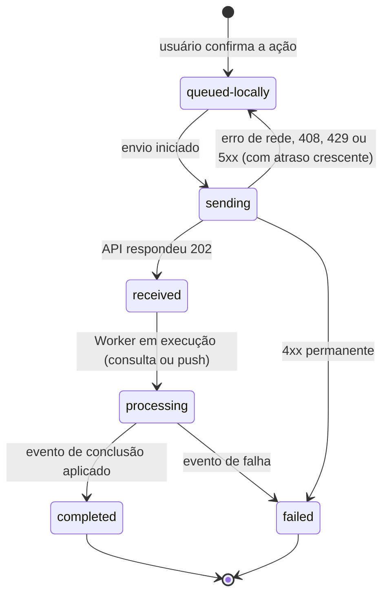

# Implementação Front-End — Aprova.AI

Guia para a equipe do aplicativo Expo (Android e iOS). Reúne tudo o que é preciso saber para implementar o app: decisões, contratos, estrutura de pastas, outbox local, consultas, push, autenticação, telas, acessibilidade, testes, build e publicação. Deriva de `docs/ARQUITETURA.md`; em caso de divergência, o documento de arquitetura prevalece.

## Sumário

1. [Base comum a todas as equipes](#1-base-comum-a-todas-as-equipes)
2. [Ponto de partida e objetivos do front-end](#2-ponto-de-partida-e-objetivos-do-front-end)
3. [Dependências propostas e como adicioná-las](#3-dependências-propostas-e-como-adicioná-las)
4. [Estrutura de pastas, camadas e regras de dependência](#4-estrutura-de-pastas-camadas-e-regras-de-dependência)
5. [Configuração do projeto](#5-configuração-do-projeto)
6. [Comandos e outbox local](#6-comandos-e-outbox-local)
7. [Consultas e consistência eventual](#7-consultas-e-consistência-eventual)
8. [Aviso de eventos: consulta periódica e push](#8-aviso-de-eventos-consulta-periódica-e-push)
9. [Autenticação no app](#9-autenticação-no-app)
10. [Telas e fluxos por contexto](#10-telas-e-fluxos-por-contexto)
11. [Design, acessibilidade e estados de interface](#11-design-acessibilidade-e-estados-de-interface)
12. [Erros, offline e desempenho](#12-erros-offline-e-desempenho)
13. [Segurança e privacidade no app](#13-segurança-e-privacidade-no-app)
14. [Testes](#14-testes)
15. [Build, publicação e atualização](#15-build-publicação-e-atualização)
16. [Ordem de implementação e critérios de aceite](#16-ordem-de-implementação-e-critérios-de-aceite)
17. [Checklist de entrega e pendências](#17-checklist-de-entrega-e-pendências)

## 1. Base comum a todas as equipes

Este capítulo é idêntico nos três guias de implementação (Front-End, Back-End e DevOps). Ele existe para que nenhuma equipe dependa de ler o guia da outra para entender o produto, as decisões, o recurso Premium, os contratos e os custos.

### 1.1 O produto e o objetivo da arquitetura

O Aprova.AI é um aplicativo para Android e iOS, feito com Expo e TypeScript, para estudo para o Enem, a Fuvest e outros vestibulares brasileiros, com correção e apoio por IA (GPT 6.1 - Terra). O objetivo técnico é duplo: o app nunca trava e nenhuma atividade em segundo plano se perde.

Para isso o sistema separa o que o aluno faz na tela (comandos, que mudam estado e respondem na hora) do que o sistema processa nos bastidores (eventos, fila e Workers, onde mora a IA) e do que o aluno consulta (modelos de leitura, eventualmente consistentes). Quando o aluno envia uma redação, a API responde `202 Accepted` em milissegundos, o app mostra “Redação recebida com sucesso!” e um Worker corrige a redação sem risco de timeout da API.

### 1.2 Estado de partida verificado em 30/10/2026

| Item | Valor verificado |
| --- | --- |
| Expo, React Native, React | `expo ~57.0.24`, `react-native 0.86.3`, `react 19.2.3` |
| TypeScript | `~6.0.3`, modo estrito (`tsconfig.json` estende `expo/tsconfig.base`) |
| Entrada do app | `index.ts` na raiz (`registerRootComponent`), que importa `src/app/App.tsx` (uma tela vazia) |
| Scripts do `package.json` | Somente `start`, `android`, `ios` e `web`. **Não existem** scripts de lint, verificação de tipos nem testes |
| Backend e infraestrutura | Não há código. Existem somente `README.md` de camada em `backend/src/*`, `contracts/`, `src/features/` e `src/core/` |
| Repositório | `GWBR-Technologies/Aprova.AI`, **público**, branches `master` e `development` |
| `.gitignore` | Cobre `.env*.local`, mas **não** `.env`; deve ser corrigido antes do primeiro uso de variáveis de ambiente |
| Dependências de runtime hoje | Apenas `expo`, `expo-status-bar`, `react` e `react-native` |

Duas observações que importam para todos. Primeiro, as regras do projeto citam `npm run lint` como o comando de qualidade, mas esse script não existe no `package.json`; a proposta P8 (§1.5) cria o script, e até lá nenhuma equipe pode afirmar que o lint passou. Segundo, como o repositório é público, tudo o que for versionado, inclusive este guia e os logs da integração contínua, é visível a qualquer pessoa: segredos, chaves e dados de alunos nunca entram nele.

### 1.3 Regras do projeto que valem para todos

- Baseie decisões no código e na configuração existentes, não em suposições sobre o produto. Declare uma suposição somente quando ela afetar o resultado; se a escolha alterar escopo, dados de medição ou risco para o usuário, peça direção.
- Mudanças enxutas: altere só os arquivos necessários, não refatore código vizinho, remova apenas o que a própria mudança tornou obsoleto e não crie abstração para um único uso.
- Não adicione dependência sem aprovação explícita. As propostas do §1.5 estão listadas justamente para serem aprovadas uma a uma.
- Não invente dados de produto: banco de questões, notas, correções, rubricas, preços e textos de marketing vêm do produto. Quando faltar o requisito, pare e peça.
- Siga os padrões existentes (React Native, componentes temáticos, arquivos específicos de plataforma) e os tokens de `src/constants/theme.ts`, que nasce no primeiro uso.
- Comentários explicam decisões, restrições e comportamento não óbvio; não há comentários TODO.
- Informe sempre os comandos executados, os resultados, as limitações e as plataformas que não puderam ser verificadas. Não afirme que algo funciona sem evidência da validação correspondente.
- Não leia, imprima, altere nem versione segredos, `.env` ou `.npmrc`. Não use comandos destrutivos (`rm -rf`, `git clean`, `git reset --hard`, push forçado).
- Commits seguem o padrão `(tipo): Frase no passado`, por exemplo `(docs): Adicionado README.md completo e estruturado desta fase inicial`, com um commit por assunto. Mensagens de commit e descrições de PR não mencionam ferramentas de assistência nem coautoria.
- Qualquer mudança de decisão ou de estrutura atualiza `docs/ARQUITETURA.md`, o `README.md`, os guias e os PDFs, na ordem do §13 do documento de arquitetura.

### 1.4 Decisões já tomadas

| Id | Decisão |
| --- | --- |
| D1 | Arquitetura geral: Event-Driven Architecture + CQRS. |
| D2 | Fila: BullMQ + Redis, atrás de uma porta única (`QueuePort`); SQS+SNS e RabbitMQ são alternativas. |
| D3 | Comandos respondem de imediato (`202 Accepted`); o trabalho pesado roda em Workers. |
| D4 | O app mantém um outbox local e envia cada comando com chave de idempotência (`commandId`). |
| D5 | O servidor grava estado e mensagem de saída na mesma transação (outbox transacional) e um relay publica na fila. |
| D6 | A IA só é chamada por Workers, atrás de `AiPort`. |
| D7 | Repositório único: app Expo na raiz, `backend/` e `contracts/`, sem workspaces nesta fase. |
| D8 | O lado de leitura é eventualmente consistente; a interface mostra estados explícitos. |
| D9 | Correção de redação por IA é exclusiva do plano `PREMIUM`, com 4 correções por mês (§1.6). |
| D10 | Todo recurso precisa de opção gratuita; custo só com aprovação explícita, exceto a IA (§1.8). |
| D11 | Hospedagem inicial na Oracle Cloud Always Free com Docker Compose; migração planejada para o Render (pago). |
| D12 | Lançamento em Android e iOS; as contas de desenvolvedor da Apple e do Google já existem e as licenças ficam fora do orçamento. |
| D13 | O domínio existente (Hostinger) serve a API por um subdomínio `api.` apontado para o servidor. |

### 1.5 Propostas que aguardam aprovação

Estas propostas são o caminho gratuito que os guias assumem. Cada uma só vira decisão depois de aprovada; até lá, ninguém instala o pacote nem cria o recurso. Todos os pacotes citados são de código aberto (licenças verificadas no registro do npm em 30/10/2026).

| Id | Proposta | Custo |
| --- | --- | --- |
| P1 | Autenticação: login com Google e com Apple (OIDC); a API valida o token do provedor e emite JWT de acesso curto e refresh token rotativo. Sem senha e sem e-mail transacional. | US$ 0 |
| P2 | Banco: PostgreSQL 18 (suporte até 14/11/2030) em uma instância, com os esquemas `write` e `read` separados. | US$ 0 |
| P3 | Backend: Node.js 24 LTS executando TypeScript nativamente (sem etapa de build), Fastify 5, Drizzle ORM com `pg`, BullMQ 6 com `ioredis`, `zod` 4 (só no backend), `pino`, `prom-client` e o SDK `openai`. | US$ 0 (exceto a IA) |
| P4 | Canal de eventos para o app: consulta periódica com intervalo crescente, com push do Expo como aviso sem dados pessoais. | US$ 0 |
| P5 | App: Expo Router, TanStack Query, `expo-sqlite`, `expo-secure-store`, `expo-notifications`, `@react-native-community/netinfo`, `expo-crypto`, `@react-native-google-signin/google-signin` e `expo-apple-authentication`. | US$ 0 |
| P6 | `contracts/` continua só com tipos; o backend valida com `zod` e garante a compatibilidade com os tipos em tempo de compilação. D7 permanece como está. | US$ 0 |
| P7 | Testes: Vitest no backend; `jest-expo` e `@testing-library/react-native` no app. | US$ 0 |
| P8 | Scripts `lint` e `typecheck` na raiz e em `backend/` (ESLint com `eslint-config-expo` no app). | US$ 0 |
| P9 | Observabilidade: Sentry (plano gratuito) para erros e Grafana Cloud (plano gratuito) para métricas e logs. | US$ 0 |
| P10 | Entrega: GitHub Actions (repositório público), GitHub Container Registry e EAS Build no plano gratuito. | US$ 0 |

A coluna de custo vale enquanto o uso ficar dentro dos limites gratuitos do §1.8. Se algum limite for ultrapassado, a equipe responsável avisa antes, com o valor estimado.

### 1.6 Recurso Premium e cota de correção de redação (D9)

Esta é uma regra de produto que atravessa as três equipes.

**Regra.** Apenas usuários com plano `PREMIUM` ativo podem enviar redação para correção por IA, e cada um tem direito a 4 correções por mês. A regra é aplicada pelo servidor no comando `SubmitEssay`; o app apenas reflete o resultado.

**Premissas a confirmar com o produto** (nenhuma foi definida na conversa de arquitetura):

- A janela da cota é o mês corrido (do dia 1 às 23h59 do último dia) no fuso `America/Sao_Paulo`, e não 30 dias móveis.
- O plano que não é Premium chama-se `FREE` nos contratos; o nome de exibição é decisão do produto.
- Uma correção já aceita é concluída mesmo que o usuário perca o Premium durante o processamento; novos envios passam a ser rejeitados.
- A cota consumida pertence ao mês em que a redação foi aceita, mesmo que o Worker termine no mês seguinte.

**Como a cota é consumida.** A reserva e a gravação da redação ocorrem na mesma transação do comando. O servidor mantém um contador por usuário e por mês e o incrementa com um `UPDATE` condicional que só tem efeito se o valor atual for menor que 4. Se nenhuma linha for afetada, a cota acabou. Isso é atômico mesmo com envios simultâneos em dois aparelhos.

| Situação | Resultado | Cota |
| --- | --- | --- |
| Usuário sem plano Premium envia redação | `403` e `PREMIUM_REQUIRED`; o app mostra a oferta do Premium. Nada é gravado. | Não consome |
| Premium com a cota esgotada | `403` e `ESSAY_QUOTA_EXCEEDED` com `limit`, `used` e `resetsAt`. Nada é gravado. | Não consome |
| Premium com cota disponível | `202`; a redação e a mensagem de saída são gravadas. | Consome 1 |
| Mesmo `commandId` reenviado (rede ruim) | `202` idêntico ao primeiro. | Não consome de novo |
| Correção termina em falha permanente (`EssayCorrectionFailed`) | O app mostra a falha e a ação de reenviar. | Devolve 1, na mesma transação que grava a falha |
| Falha transitória que acaba corrigindo após novas tentativas | `EssayCorrected`. | Mantém o 1 consumido |
| Virada de mês com a correção em andamento | A correção conclui normalmente. | Fica no mês da submissão |

**O que a interface precisa mostrar.** Para o usuário Premium, quantas correções restam no mês e quando renovam (`used`, `limit` e `resetsAt` vêm da consulta de direitos, §1.7). Para quem não é Premium, a oferta do Premium no ponto de envio da redação; o texto e o preço dependem do produto e não são inventados aqui. Em ambos os casos a informação vem do servidor, nunca de contagem local.

**Testes exigidos para esta regra** (back-end, com apoio do front-end nas telas): usuário sem Premium; Premium com 0, 3 e 4 usos; duas submissões simultâneas com 3 usos (apenas uma passa); reenvio do mesmo `commandId`; falha permanente devolvendo a cota; virada de mês em `America/Sao_Paulo` (por exemplo 31/10 às 23h59 e 01/11 às 00h00 no horário de Brasília); e perda do Premium durante o processamento.

**Em aberto (§1.8 e §14 do documento de arquitetura).** Como o usuário se torna Premium (assinatura, cobrança, preço, período de teste) ainda não foi decidido. A arquitetura isola isso atrás da `EntitlementPort`: o backend só pergunta “qual é o plano deste usuário agora?”. Enquanto a fonte real não existir, nenhuma equipe deve criar um mecanismo de concessão de Premium por conta própria.

### 1.7 Contratos entre o app e o backend

Todos os contratos moram em `contracts/` como **tipos** (sem lógica e sem código executável) e são a única fonte de verdade do formato. Um contrato novo só entra com aprovação.

**Comandos.** `POST /v1/commands/<nome-em-kebab-case>` com o corpo abaixo. O sucesso é sempre `202`.

```ts
// contracts/commands/command-envelope.ts (somente tipos)
export type CommandEnvelope<TPayload> = {
  commandId: string; // UUID v4 gerado no app; é a chave de idempotência
  issuedAt: string;  // ISO 8601 em UTC
  payload: TPayload;
};

export type CommandAccepted = {
  commandId: string;
  status: 'accepted';
  receivedAt: string; // ISO 8601 em UTC
};

// contracts/commands/submit-essay.command.ts
export type SubmitEssayPayload = {
  essayId: string; // UUID gerado no app
  text: string;
  // Tema e limites de tamanho do texto são definidos com o produto (§14).
};
```

**Comandos iniciais** (§5 do documento de arquitetura): `AnswerQuestion`, `RecordRoutineProgress`, `SubmitEssay` e `CompleteMockExam`. Os campos de negócio de cada payload (identificador da questão, alternativa, tempo, duração e assim por diante) são definidos com o produto antes da implementação; nenhuma equipe os inventa.

**Consultas.** `GET /v1/...`; toda resposta traz `asOf` (ISO 8601 em UTC) com o instante da última projeção aplicada.

| Consulta | Rota | Resposta (resumo) |
| --- | --- | --- |
| `GetEssay` | `GET /v1/essays/{essayId}` | `status` (`processing`, `completed`, `failed`), `result` quando concluída, `failure` quando falhou, `asOf`; `404` enquanto a projeção ainda não foi aplicada |
| `GetEssayList` (proposta, precisa de aprovação) | `GET /v1/me/essays` | Redações do usuário com `status` e data, paginadas, `asOf` |
| `GetEntitlements` | `GET /v1/me/entitlements` | `plan` (`FREE` ou `PREMIUM`) e `essayQuota` (`limit`, `used`, `resetsAt`) ou `null` quando não há direito, `asOf` |
| `GetPerformanceSummary` | `GET /v1/me/performance` | Estatísticas de desempenho do read store, `asOf` |
| `GetMockExamHistory` | `GET /v1/me/mock-exams` | Histórico de simulados, `asOf` |
| `GetMockExamResult` | `GET /v1/mock-exams/{mockExamId}` | `status` e resultado consolidado, `asOf` |

O formato do `result` da redação depende da rubrica (em aberto) e não é definido aqui. O estado `received` do app é do **outbox local** (a API respondeu `202`); no servidor, uma redação aceita já está `processing`, e logo depois do `202` a consulta pode devolver `404` porque a projeção é assíncrona. O app trata esse `404` transitório como “em processamento”.

**Erros.** Toda resposta de erro tem o mesmo corpo, que nunca expõe detalhes internos:

```ts
export type ApiError = {
  code: ErrorCode;
  message: string;        // texto compreensível para o aluno
  correlationId: string;  // igual ao commandId quando houver
  details?: Record<string, unknown>;
};
```

| Status | `code` | Quando | O app deve |
| --- | --- | --- | --- |
| 400 | `VALIDATION_FAILED` | Corpo, parâmetro ou cabeçalho inválido | Marcar o comando como falho e mostrar a correção necessária |
| 401 | `UNAUTHENTICATED` | Token ausente, inválido ou expirado | Renovar o token; se falhar, pedir novo login |
| 403 | `PREMIUM_REQUIRED` | Plano sem direito à correção | Mostrar a oferta do Premium; não reenviar |
| 403 | `ESSAY_QUOTA_EXCEEDED` | Cota mensal esgotada (`limit`, `used`, `resetsAt`) | Informar quando renova; não reenviar |
| 409 | `COMMAND_ID_CONFLICT` | Mesmo `commandId` com payload diferente | Tratar como bug; registrar e não reenviar |
| 429 | `RATE_LIMITED` | Excesso de requisições | Reenviar depois de `Retry-After` |
| 500 | `INTERNAL_ERROR` | Falha inesperada | Reenviar com intervalo crescente |
| 503 | `SERVICE_UNAVAILABLE` | Dependência fora do ar | Reenviar com intervalo crescente |

Regra de reenvio do outbox: reenviar erros de rede, `408`, `429` e `5xx`; nunca reenviar os demais `4xx`, que são permanentes e terminam o comando como `failed`.

**Autenticação.** `POST /v1/auth/login` (`{ provider, idToken }`, com `provider` igual a `google` ou `apple`), `POST /v1/auth/refresh` e `POST /v1/auth/logout` são endpoints HTTP síncronos, fora do modelo de comandos, porque devolvem tokens e não `202`. O login devolve `{ accessToken, accessTokenExpiresAt, refreshToken }`. Dependem da proposta P1.

**Comando técnico proposto.** `RegisterPushToken` (idempotente por token) só existe se a proposta P4 for aprovada; não faz parte do conjunto inicial.

**Aviso por push.** O push do Expo é só um aviso para o app consultar de novo. O corpo é `{ type, aggregateId, correlationId }`, com `type` igual a `EssayCorrected`, `EssayCorrectionFailed` ou `MockExamProcessed`. Nunca carrega texto de redação, nota ou dado pessoal.

**Evolução.** As rotas são versionadas por prefixo (`/v1`). Mudança compatível (campo opcional novo) não muda a versão; mudança incompatível cria `/v2` e mantém `/v1` até o último app que a usa sair de circulação.

### 1.8 Custos e recursos gratuitos (D10)

Regra do projeto: toda decisão deve ter opção gratuita, exceto a IA. A tabela abaixo lista cada recurso, o limite gratuito consultado em 30/10/2026 nas páginas oficiais, o que acontece ao passar dele e o custo por 1.000 usuários quando faz sentido. Itens marcados com † vêm de conhecimento anterior e não foram reverificados nesta data.

| Recurso | Limite gratuito | Custo ao ultrapassar | Por 1.000 usuários |
| --- | --- | --- | --- |
| Oracle Cloud Always Free (D11) | VM Ampere A1 (2 OCPU e 12 GB no total, conforme a página consultada), 2 VMs AMD micro (1 GB cada), 200 GB de disco, 10 TB/mês de saída | Passar a Pay As You Go; o que fica dentro do Always Free segue sem cobrança | US$ 0 (carga a validar em teste) |
| GitHub Actions e repositório | Uso gratuito para repositório público | Repositório privado tem créditos incluídos limitados; consultar antes de privatizar | US$ 0 |
| GitHub Container Registry † | Gratuito para pacotes públicos | Não verificado | US$ 0 |
| EAS Build (plano Free) | 15 builds Android e 15 iOS por mês, fila de baixa prioridade | Starter US$ 19/mês (US$ 45 de crédito de build); Production US$ 199/mês (US$ 225) | US$ 0 |
| EAS Update (opcional) | 1.000 usuários ativos por mês | Starter inclui 3.000 e Production 50.000; acima, preço por uso (valor não publicado na página) | US$ 0 até 1.000 usuários ativos |
| Sentry (plano Developer) | 5 mil erros, 1 usuário, 30 dias de histórico | Team: US$ 29/mês (US$ 26 no plano anual) | US$ 0 |
| Grafana Cloud (plano Free) | 10 mil séries de métricas, 50 GB de logs, 50 GB de traces, 3 usuários, 14 dias de retenção | Pro a partir de US$ 19/mês mais uso | US$ 0 |
| HTTPS (Let's Encrypt pelo Caddy) † | Gratuito | — | US$ 0 |
| Login com Google e com Apple † | Gratuito (a Apple exige a conta de desenvolvedor, que já existe) | — | US$ 0 |
| Push do Expo | A documentação consultada não informa preço nem limites | Confirmar antes de depender em volume | A confirmar |
| Credenciais de push do Android (Firebase) † | Projeto Firebase gratuito | — | US$ 0 |
| Domínio e DNS (D13) | Domínio já existente na Hostinger | — | US$ 0 |
| Contas Apple e Google Play (D12) | Já existem; licenças fora do orçamento | — | Fora do escopo |
| Render (rota de migração) | Redis gratuito de 25 MB sem persistência em disco: incompatível com o BullMQ | Web US$ 7/mês, Postgres US$ 6/mês (1 GB), Key Value US$ 10/mês (256 MB), total US$ 23/mês; Worker separado não verificado | ≈ US$ 0,023 por usuário/mês (US$ 23 a cada 1.000) |

**Custo da IA (GPT 6.1 - Terra), único custo que cresce por usuário.** Preços por 1 milhão de tokens na página oficial de preços da OpenAI (modelo `gpt-6.1-terra`, camada padrão): entrada US$ 1,00; entrada em cache US$ 0,05; saída US$ 5,00; gravação em cache de 30 minutos US$ 1,25; de 12 horas US$ 2,50. A mesma página mostra uma segunda linha para o modelo com metade desses valores, que parece ser a camada flex ou batch (o rótulo não está explícito, por isso não é usada nas contas).

As quantidades de tokens abaixo são **estimativas de arquitetura, não medições**: cerca de 3.500 tokens de entrada por correção (texto da redação mais prompt e critérios, dos quais cerca de 1.500 formam um prefixo estável) e 1.000 de saída. A tabela de custo por 1.000 assinantes Premium assume o teto de uso (todos usam as 4 correções do mês, ou seja, 4.000 correções):

| Cenário | Custo por correção | Custo por mês a cada 1.000 assinantes Premium |
| --- | --- | --- |
| Sem cache (3.500 de entrada e 1.000 de saída) | US$ 0,0085 | **US$ 34,00** |
| Prefixo de 1.500 tokens servido do cache em todas as chamadas | US$ 0,0071 | US$ 28,30 |
| Saída de 2.000 tokens, sem cache | US$ 0,0135 | US$ 54,00 |

O custo por assinante fica em no máximo US$ 0,034 por mês no cenário base. Para estimar o custo por mil usuários totais, multiplique pela fração de assinantes: com 10% de Premium, US$ 3,40 a cada 1.000 usuários; com 25%, US$ 8,50. O cache só compensa se o prefixo for reaproveitado: escrever custa 25% a mais que a entrada comum e cada leitura economiza cerca de 95%, então basta uma leitura a cada quatro escritas para valer a pena. Todos os números serão substituídos pelo consumo real registrado pelo Worker (tabela `ai_usage`, guia do Back-End) logo nas primeiras semanas.

**Custos que dependem do Premium e ainda não foram decididos.** Se o Premium for vendido pelas lojas, as comissões consultadas hoje são: Apple 15% no Small Business Program (receita de até US$ 1 milhão no ano anterior); Google Play 15% sobre assinaturas nos mercados que não estão entre os de estrutura nova (a página lista Austrália, Espaço Econômico Europeu, Japão, Reino Unido e EUA com 10% mais 5% de cobrança). Se for usado o RevenueCat para gerir assinaturas, a página informa que não há cobrança até US$ 2.500 de receita mensal rastreada e 1% acima disso (a página não esclarece se o 1% incide só sobre o excedente). Se o Premium precisa ou não usar a cobrança das lojas depende das diretrizes de cada loja e deve ser confirmado antes de implementar. Nada disso está aprovado: o item segue em aberto (§14 do documento de arquitetura).

### 1.9 Glossário

| Termo | Significado |
| --- | --- |
| Comando | Intenção do aluno de mudar o estado; verbo no imperativo (`SubmitEssay`). Responde `202`, nunca o resultado. |
| Consulta | Leitura de um modelo de leitura; nunca muda estado; devolve `asOf`. |
| Evento | Fato já ocorrido e imutável, nomeado no passado (`EssaySubmitted`). |
| `commandId` | UUID gerado no app; chave de idempotência e `correlationId` de toda a cadeia. |
| Outbox local | Fila de comandos pendentes no aparelho, enviada quando houver conexão. |
| Outbox transacional | Tabela do servidor gravada na mesma transação do estado; um relay publica na fila. |
| Relay | Processo que lê o outbox transacional e publica no BullMQ. |
| Worker | Processo sem servidor HTTP que consome uma fila (correção de redação, simulados, projeções). |
| Projeção (read model) | Tabela desnormalizada atualizada por eventos, usada só por consultas. |
| `asOf` | Instante da última projeção aplicada; indica o possível atraso do dado. |
| Dead-letter | Fila de mensagens que esgotaram as tentativas ou falharam de forma permanente. |
| AOF | Persistência do Redis por log de comandos, exigida pelo BullMQ em produção. |
| Premium | Plano com direito à correção de redação por IA (4 por mês). |
| MAU | Usuários ativos por mês (base de cobrança do EAS Update). |

### 1.10 Fontes consultadas em 30/10/2026

Preços, limites e versões deste guia vêm das páginas oficiais abaixo. Quem for implementar deve reconferi-las, porque planos e limites mudam.

- Oracle Always Free: `docs.oracle.com/en-us/iaas/Content/FreeTier/freetier_topic-Always_Free_Resources.htm`.
- BullMQ: `docs.bullmq.io/guide/going-to-production`, `.../jobs/job-ids` e `.../retrying-failing-jobs`; tipos do pacote `bullmq` 6.5.2.
- Expo: `expo.dev/pricing` e `docs.expo.dev/push-notifications/overview`.
- Render: `render.com/pricing`. Sentry: `sentry.io/pricing`. Grafana: `grafana.com/pricing`.
- OpenAI: `developers.openai.com/api/docs/pricing` (linha `gpt-6.1-terra`).
- Lojas e assinaturas: `developer.apple.com/app-store/small-business-program`, `support.google.com/googleplay/android-developer/answer/112622` e `revenuecat.com/pricing`.
- Ciclo de vida: `nodejs.org/en/about/previous-releases`, `endoflife.date/postgresql` e `endoflife.date/redis`.
- Versões e licenças de pacotes: registro do npm, consultado em 30/10/2026.

## 2. Ponto de partida e objetivos do front-end

Hoje o app é uma tela vazia em `src/app/App.tsx`, registrada por `index.ts`. Não há navegação, cliente de rede, persistência, estado de servidor, tema, testes nem lint. Tudo o que está neste guia nasce incrementalmente, seguindo a regra do projeto de criar pastas e arquivos no primeiro uso real.

O front-end tem cinco responsabilidades:

1. Capturar a intenção do aluno como **comando** e entregá-lo ao outbox local, sem nunca perdê-lo (D4).
2. Enviar os comandos à API com `commandId` como chave de idempotência, tratando cada resposta de erro de forma correta (§1.7).
3. Ler **modelos de leitura** pela API de consultas, tratando o atraso (`asOf`) como parte da interface (D8).
4. Descobrir que um processamento terminou (push do Expo e consulta periódica) e atualizar a tela.
5. Mostrar sempre um estado explícito e compreensível, acessível por leitor de tela, nunca só por cor.

O app **nunca** chama a IA, **nunca** guarda chave de API e **nunca** decide se o usuário é Premium ou quantas correções restam: lê isso do servidor (§1.6).

## 3. Dependências propostas e como adicioná-las

Nenhum pacote abaixo está instalado. Cada grupo é uma proposta (P5, P7 e P8, §1.5) que precisa de aprovação explícita antes de entrar no `package.json`. Todos têm licença MIT (verificado no npm em 30/10/2026) e custo zero.

**Regra de instalação.** O npm publica hoje a linha 58 dos pacotes do Expo (por exemplo `expo-sqlite 58.0.14`), enquanto o projeto está na SDK 57. Por isso pacotes do ecossistema Expo são instalados **somente** com `npx expo install <pacote>`, que escolhe a versão compatível com a SDK 57. Em seguida roda-se `npx expo-doctor` para detectar incompatibilidades. Nunca use `npm install expo-...` direto nem `latest`.

| Pacote | Para quê | Como instalar | Observações |
| --- | --- | --- | --- |
| `expo-router` e peers | Navegação por arquivos em `src/app/` | `npx expo install expo-router` | Muda a composição do app (§5.3); aprovar antes |
| `@tanstack/react-query` | Estado de servidor das consultas, cache e consulta periódica | `npm install @tanstack/react-query` | Não é pacote do Expo; versão atual 5.105.0 |
| `expo-sqlite` | Persistência do outbox local | `npx expo install expo-sqlite` | Funciona em Android e iOS |
| `expo-secure-store` | Guardar o refresh token | `npx expo install expo-secure-store` | Keychain no iOS e Keystore no Android |
| `expo-crypto` | `randomUUID()` para `commandId` e identificadores | `npx expo install expo-crypto` | O motor Hermes não oferece `crypto.randomUUID` garantido |
| `@react-native-community/netinfo` | Saber quando a rede volta | `npx expo install @react-native-community/netinfo` | Dispara o envio do outbox |
| `expo-notifications` | Push do Expo e canais Android | `npx expo install expo-notifications` | Push exige build de desenvolvimento, não o Expo Go † |
| `@react-native-google-signin/google-signin` | Login com Google nativo | `npx expo install @react-native-google-signin/google-signin` | Exige plugin de configuração e build nativo |
| `expo-apple-authentication` | Login com Apple | `npx expo install expo-apple-authentication` | Somente iOS |
| `@sentry/react-native` | Erros do app (P9) | `npx expo install @sentry/react-native` | Plano gratuito: 5 mil erros por mês |
| `jest-expo`, `@testing-library/react-native` | Testes do app (P7) | `npx expo install jest-expo` e `npm install -D @testing-library/react-native` | Dependências de desenvolvimento |
| `eslint` e `eslint-config-expo` | Script `lint` (P8) | `npx expo lint` configura na primeira execução | Conferir o resultado antes de commitar |

† Comportamento conhecido da documentação do Expo e não reverificado nesta data; confirmar na documentação da SDK 57.

**O app não usa `zod`.** A validação em tempo de execução fica no backend (P6). No app, os tipos de `contracts/` bastam, porque o app produz os comandos por código tipado e consome respostas do próprio servidor. Se algum dia for necessário validar respostas no app, isso volta a ser uma proposta nova.

**Uma proposta por PR.** Cada aprovação gera um commit separado (`(deps): Adicionado expo-sqlite para o outbox local`), com a justificativa em uma frase e o resultado de `npx expo-doctor`.

## 4. Estrutura de pastas, camadas e regras de dependência

A estrutura alvo está em `docs/ARQUITETURA.md` (§10). Para o front-end:

```text
index.ts                    # Entrada (muda se o Expo Router for aprovado, §5.3)
src/
├── app/                    # Composição: providers e navegação (ou rotas, com Expo Router)
├── features/
│   ├── questions/          # Responder questões
│   ├── routine/            # Rotina de estudo
│   ├── mock-exams/         # Simulados
│   ├── essay/              # Redação
│   │   ├── commands/       # submit-essay.command.ts
│   │   ├── queries/        # use-essay.query.ts, use-essay-quota.query.ts, essay.mapper.ts
│   │   ├── events/         # essay-events.ts (reação a push e invalidação)
│   │   └── ui/             # EssayComposerScreen.tsx, EssayStatusCard.tsx, PremiumGate.tsx
│   └── performance/        # Desempenho e evolução
├── core/
│   ├── api/                # Cliente HTTP, classificação de erro, renovação de token
│   ├── outbox/             # Fila local de comandos (expo-sqlite)
│   ├── storage/            # SecureStore e preferências
│   └── events/             # Registro de push e ouvintes
├── components/             # UI compartilhada (Button, StatusBadge, ...)
├── hooks/                  # Hooks compartilhados sem dependência de rede
└── constants/theme.ts      # Tokens visuais
```

Só nasce o que tem uso real: um contexto novo surge com um comando, uma consulta ou uma tela de verdade, e `theme.ts`, `components/` e `hooks/` nascem na primeira tela.

### 4.1 Regras de dependência (resumo do §10.3 da arquitetura)

| Camada | Pode importar | Não pode importar |
| --- | --- | --- |
| `src/app` | `features/*`, `core`, `components`, `hooks`, `constants` | — |
| `src/features/<contexto>` | `core`, `components`, `hooks`, `constants`, `contracts` | Outro contexto; `app` |
| `src/core` | `contracts` | `features`, `app`, `components` |
| `src/components` | `hooks`, `constants` | `features`, `core`, `app` |
| `src/hooks`, `src/constants` | `constants` | `features`, `core`, `app`, `components` |
| `contracts` | Apenas `contracts` | `src`, `backend` |

A regra mais fácil de quebrar sem perceber: **um contexto nunca importa outro**. Exemplo real deste projeto: a tela de redação precisa saber o plano e a cota (`GetEntitlements`), e o futuro contexto de conta também vai usar essa consulta. Cada contexto implementa a sua própria leitura (`essay/queries/use-essay-quota.query.ts`), mapeando a resposta para o modelo de tela que lhe interessa, e só o **tipo** da resposta fica em `contracts/queries`. Duplicar um hook de 15 linhas é mais barato do que acoplar dois contextos.

### 4.2 Convenções

- Pastas em kebab-case e um arquivo por responsabilidade. Sufixos por papel: `*.command.ts`, `*.query.ts`, `*.event.ts`, `*.mapper.ts`. Componentes React em PascalCase (`EssayComposerScreen.tsx`).
- Arquivos específicos de plataforma ficam ao lado do nativo (`Button.web.tsx`).
- Tipos ficam junto do único consumidor; só vão para `contracts/` quando o app e o backend usam o mesmo tipo.
- Comandos e telas chamam o handler diretamente: não existe barramento genérico de comandos.
- Os aliases `@/` (para `src/`) e `@contracts/` (para `contracts/`) entram no primeiro uso (§5.1).

## 5. Configuração do projeto

### 5.1 `tsconfig.json` com aliases

Validado em 30/10/2026 numa cópia do projeto: com a configuração abaixo, `npx tsc --noEmit` passou e `npx expo export --platform android` gerou o bundle resolvendo `@/` e um `import type` de `@contracts/`. Não é preciso configurar Babel nem Metro (a SDK 57 lê `paths` do `tsconfig.json`).

```json
{
  "extends": "expo/tsconfig.base",
  "compilerOptions": {
    "strict": true,
    "paths": {
      "@/*": ["./src/*"],
      "@contracts/*": ["./contracts/*"]
    }
  },
  "exclude": ["backend"]
}
```

Não use `baseUrl`: o TypeScript 6 o marca como obsoleto. O `exclude` de `backend` entra quando `backend/package.json` existir. Todo import de `contracts/` no app é `import type`, porque o diretório contém apenas tipos.

### 5.2 Scripts de qualidade (P8)

O `package.json` não tem `lint` nem `typecheck`. Depois da aprovação:

```json
{
  "scripts": {
    "lint": "expo lint",
    "typecheck": "tsc --noEmit",
    "test": "jest"
  }
}
```

Até esses scripts existirem, a única verificação possível é manual (`npx tsc --noEmit` e `npx expo export --platform android`) e o relatório da tarefa deve dizer isso, sem afirmar que o lint passou.

### 5.3 Expo Router (proposta)

Se aprovado, a composição de `src/app/App.tsx` migra para rotas, e o §10.4 do documento de arquitetura precisa ser atualizado no mesmo PR. Passos (conferir a documentação do Expo Router da SDK 57 antes, pois não foram reverificados nesta data):

1. `npx expo install expo-router` e os pacotes que a documentação pedir (`react-native-safe-area-context`, `react-native-screens`, `expo-linking`, `expo-constants`).
2. `package.json`: `"main": "expo-router/entry"`; `index.ts` deixa de ser usado e é removido.
3. `app.json`: `"scheme": "aprovaai"` e o plugin `expo-router`. O esquema é necessário para abrir uma tela a partir de um push.
4. `src/app/_layout.tsx` recebe os providers (`QueryClientProvider`, tema) e `src/app/index.tsx` vira a primeira tela. A partir daí `src/app/` contém **somente rotas** finas que renderizam telas de `features/<contexto>/ui`.

### 5.4 Variáveis de ambiente

Variáveis `EXPO_PUBLIC_*` são embutidas no bundle e portanto **públicas**. Só entram nelas valores que podem ser vistos por qualquer pessoa: `EXPO_PUBLIC_API_URL` (URL da API, `https://api.<domínio>`), o identificador de cliente OAuth do Google e o DSN do Sentry. Nenhuma chave de IA, de banco ou de assinatura de token existe no app. Arquivos `.env` precisam estar no `.gitignore` antes do primeiro uso (hoje só `.env*.local` está coberto).

## 6. Comandos e outbox local

### 6.1 Ciclo de vida de um comando


<!-- caption: Figura 1 — Estados de um comando no app -->

O outbox é responsável apenas pelos estados até `received` (ou `failed` por rejeição). Os estados `processing` e `completed` vêm da consulta do recurso (por exemplo `GetEssay`), e a interface os combina com o estado do outbox em um único estado de tela (§6.5).

### 6.2 Tabela do outbox (SQLite)

Cada linha é um comando pendente. O `user_id` impede que um comando criado por um usuário seja enviado em nome de outro depois de uma troca de conta.

```sql
CREATE TABLE IF NOT EXISTS outbox (
  command_id      TEXT PRIMARY KEY,
  user_id         TEXT NOT NULL,
  route           TEXT NOT NULL,     -- ex.: 'submit-essay'
  resource_id     TEXT,              -- id do recurso criado (ex.: essayId); não é dado pessoal
  body            TEXT,              -- JSON do envelope; nulo depois de 'received'
  state           TEXT NOT NULL,     -- queued-locally | sending | received | failed
  attempts        INTEGER NOT NULL DEFAULT 0,
  next_attempt_at INTEGER NOT NULL,  -- epoch em milissegundos
  last_error_code TEXT,
  created_at      INTEGER NOT NULL,
  updated_at      INTEGER NOT NULL
);
CREATE INDEX IF NOT EXISTS outbox_due ON outbox (user_id, state, next_attempt_at);
```

### 6.3 Regras do outbox

- **Gravar antes de enviar.** O comando é gravado no SQLite e só depois enviado. Se o app for encerrado entre as duas etapas, nada se perde.
- **Recuperação de queda.** Na inicialização, toda linha em `sending` volta para `queued-locally`. Isso é seguro porque o `commandId` é a chave de idempotência: um reenvio que já havia chegado ao servidor devolve o mesmo `202` sem repetir o efeito.
- **Ordem.** O envio é sequencial por ordem de `created_at`. Um erro de rede interrompe a rodada (evita reordenar); uma rejeição permanente marca só aquele comando como `failed` e segue para o próximo.
- **Atraso crescente.** `delay = min(2^attempts × 2 s, 5 min)` mais um sorteio de até 20% (jitter), para que muitos aparelhos não reenviem ao mesmo tempo. Se a resposta for `429` com `Retry-After`, vale o maior dos dois.
- **Gatilhos de envio.** Abertura do app, volta ao primeiro plano (`AppState`), volta da rede (`NetInfo`), logo após gravar um comando e um temporizador para o próximo `next_attempt_at`. Só uma rodada roda por vez.
- **Privacidade.** Depois de `received`, o campo `body` é apagado (o servidor já tem o texto). Linhas `failed` mantêm o `body` até o usuário reenviar ou descartar, para que ele não perca o que escreveu.
- **Troca de conta.** Só linhas do `user_id` atual são enviadas. O logout com comandos pendentes exige confirmação explícita e descarta os pendentes daquele usuário.
- **Limpeza.** Linhas `received` com mais de 7 dias são removidas (valor inicial a calibrar).

### 6.4 Exemplo: comando de envio de redação

O arquivo vive em `src/features/essay/commands/submit-essay.command.ts`. A função é o único ponto que a tela chama; ela não faz rede.

```ts
import * as Crypto from 'expo-crypto';
import type { CommandEnvelope } from '@contracts/commands/command-envelope';
import type { SubmitEssayPayload } from '@contracts/commands/submit-essay.command';
import { enqueueCommand } from '@/core/outbox/outbox';

export async function submitEssay(userId: string, text: string) {
  const command: CommandEnvelope<SubmitEssayPayload> = {
    commandId: Crypto.randomUUID(),
    issuedAt: new Date().toISOString(),
    payload: { essayId: Crypto.randomUUID(), text },
  };
  await enqueueCommand({ userId, route: 'submit-essay', command });
  return { commandId: command.commandId, essayId: command.payload.essayId };
}
```

O núcleo do outbox (`src/core/outbox/outbox.ts`) expõe quatro operações. O esboço abaixo mostra o contrato, não a implementação final:

```ts
export type OutboxState = 'queued-locally' | 'sending' | 'received' | 'failed';

export async function enqueueCommand(input: {
  userId: string;
  route: string;
  command: { commandId: string };
}): Promise<void>; // grava e dispara flushOutbox()

export async function flushOutbox(userId: string): Promise<void>;
// 1. reseta 'sending' órfãos (apenas na primeira rodada após iniciar)
// 2. seleciona linhas vencidas em ordem de created_at
// 3. para cada uma: marca 'sending', faz POST, aplica a tabela de erros do §1.7

export function observeOutbox(commandId: string, listener: (s: OutboxState) => void): () => void;

export async function discardOutbox(commandId: string): Promise<void>;
```

### 6.5 Estado de tela de um comando

A tela mostra um único estado, derivado do outbox e da consulta:

| Estado | Origem | Texto sugerido | Ação |
| --- | --- | --- | --- |
| `queued-locally` | Outbox | “Sem conexão no momento. Enviaremos assim que houver internet.” | Nenhuma; opção de cancelar |
| `sending` | Outbox | “Enviando…” (com indicador de carregamento) | Botão de envio desabilitado |
| `received` | Outbox (`202`) | “Redação recebida com sucesso!” | Mostrar que a correção está na fila |
| `processing` | Consulta (`processing` ou `404` transitório) | “Estamos corrigindo sua redação. Avisaremos quando terminar.” | Pode sair da tela |
| `completed` | Consulta (`completed`) | Mostrar a correção | — |
| `failed` | Outbox (rejeição) ou consulta (`failed`) | Mensagem do código de erro (§12.2) | Reenviar, descartar ou ver a oferta Premium |

Os textos são sugestões: o produto pode alterá-los, mas a confirmação “Redação recebida com sucesso!” só aparece **depois do `202`**, nunca no toque do botão. Todo estado é comunicado por texto, e mudanças são anunciadas por tecnologia assistiva (§11.3).

### 6.6 Reenvio depois de falha

- Rejeições `PREMIUM_REQUIRED` e `ESSAY_QUOTA_EXCEEDED` não gravaram nada no servidor: o texto continua no outbox como `failed`. Depois de assinar o Premium ou na renovação da cota, o usuário reenvia criando **novo `commandId`** (é uma nova intenção).
- `EssayCorrectionFailed` (a redação chegou, a correção falhou) já existe no servidor. Até existir um comando de reprocesso aprovado, “reenviar” cria uma nova redação com novo `essayId`, e o servidor devolveu a cota da falha (§1.6).
- Nunca reutilize um `commandId` com payload diferente: o servidor responde `COMMAND_ID_CONFLICT`.

## 7. Consultas e consistência eventual

### 7.1 Cliente HTTP

`src/core/api` concentra a rede. A interface nunca chama `fetch` diretamente. O cliente:

- usa `EXPO_PUBLIC_API_URL`, sempre por HTTPS;
- injeta o token de acesso e renova uma vez em caso de `401` (§9.3);
- traduz a resposta no tipo `ApiError` (§1.7) e classifica o erro em **reenviável** (rede, `408`, `429`, `5xx`) ou **permanente** (demais `4xx`);
- define tempo limite por requisição (valor inicial de 15 s para comandos e consultas) com `AbortController`.

### 7.2 Estado de servidor com TanStack Query (P5)

Cada consulta é um hook em `features/<contexto>/queries`. A chave inclui o identificador do recurso; o mapeador converte o DTO de `contracts/queries` no modelo de tela.

```ts
import { useQuery } from '@tanstack/react-query';
import type { EssayView } from '@contracts/queries/get-essay.query';
import { apiGet } from '@/core/api/client';
import { nextPollInterval } from '@/core/events/poll-interval';

export function useEssay(essayId: string) {
  return useQuery({
    queryKey: ['essay', essayId],
    queryFn: () => apiGet<EssayView>(`/v1/essays/${essayId}`),
    refetchInterval: (query) => {
      const status = query.state.data?.status;
      return status === 'completed' || status === 'failed'
        ? false
        : nextPollInterval(query.state.dataUpdateCount);
    },
  });
}
```

Integre a biblioteca ao ciclo de vida do React Native uma única vez, em `src/app` (ou `_layout.tsx`): `focusManager` ligado ao `AppState` e `onlineManager` ligado ao `NetInfo`, de modo que consultas pausem sem rede e revalidem ao voltar ao app.

### 7.3 `404` logo depois do `202`

Como a projeção é assíncrona, `GetEssay` pode devolver `404` nos primeiros instantes depois do `202`. Quando existe uma linha do outbox em `received` para aquele `essayId`, o app trata o `404` como “em processamento” e continua a consulta periódica; sem essa linha (por exemplo, a redação foi enviada de outro aparelho), `404` significa que o recurso não existe.

### 7.4 Tratamento de `asOf`

Toda resposta traz `asOf`. A interface mostra “Atualizado há X” em telas de estatística e, em recursos em processamento (redação, simulado), nunca apresenta um dado antigo como definitivo: enquanto o `status` não for `completed`, o texto é de processamento. Quando chega um evento relacionado (push), a consulta é invalidada (`invalidateQueries`) e o `asOf` novo substitui o antigo.

### 7.5 Regras de cache

- `GetEntitlements` é revalidada ao abrir a tela de redação e depois de qualquer rejeição `PREMIUM_REQUIRED` ou `ESSAY_QUOTA_EXCEEDED`, para que a interface nunca mostre “restam 2” com base em contagem antiga.
- Consultas de desempenho podem ficar “frescas” por alguns minutos (valor a calibrar com o produto) e são invalidadas por eventos de simulado e de resposta.
- O cache em memória não guarda texto de redação; o texto pendente fica só no outbox local.

## 8. Aviso de eventos: consulta periódica e push

A proposta P4 combina duas fontes, e o app funciona corretamente com apenas uma delas.

### 8.1 Consulta periódica com intervalo crescente

Enquanto o app está em primeiro plano e o recurso está em `received` ou `processing`, a consulta repete com intervalos crescentes: 3 s, 5 s, 8 s, 13 s, 20 s e depois 30 s (valores iniciais a calibrar). Após 5 minutos sem conclusão, a consulta pausa e a tela diz “Ainda estamos processando. Avisaremos quando terminar.” O app em segundo plano não consulta; quem avisa é o push.

```ts
// src/core/events/poll-interval.ts (implementado; `attempt` = consultas já concluídas)
const STEPS_MS = [3_000, 5_000, 8_000, 13_000, 20_000, 30_000];
const GIVE_UP_AFTER_MS = 5 * 60_000;

export function nextPollInterval(attempt: number): number | false {
  const last = STEPS_MS.length - 1;
  const stepsTaken = Math.min(attempt, STEPS_MS.length);
  const elapsed =
    STEPS_MS.slice(0, stepsTaken).reduce((total, step) => total + step, 0) +
    Math.max(0, attempt - STEPS_MS.length) * STEPS_MS[last];
  if (elapsed >= GIVE_UP_AFTER_MS) return false;
  return STEPS_MS[Math.min(attempt, last)];
}
```

O esboço original somava no máximo os seis primeiros degraus (79 s) e por isso nunca parava aos 5 minutos; a versão acima conta também as tentativas extras de 30 s. Além disso o contador usa `dataUpdateCount + errorUpdateCount`: durante o `404` transitório a consulta falha ou devolve `null`, e só contar atualizações com dado manteria o intervalo preso em 3 s.

### 8.2 Push do Expo

O push é só um aviso para o app consultar de novo. Dependências: `expo-notifications`, build de desenvolvimento e credenciais (Android: projeto Firebase para FCM; iOS: chave APNs gerenciada pelo EAS, usando a conta Apple que já existe). Detalhes de credenciais estão no guia de DevOps.

1. **Pedir permissão no contexto certo**, por exemplo depois do primeiro envio de redação (“Quer ser avisado quando a correção terminar?”), nunca na abertura do app. Se negada, o app segue só com consulta periódica.
2. **Registrar o token.** O app obtém o token do Expo e o envia à API pelo comando técnico `RegisterPushToken` (idempotente por token). Esse comando não está no conjunto inicial e **precisa de aprovação junto da P4**; ele passa pelo mesmo outbox.
3. **Android:** criar o canal `essay` (importância padrão) antes de pedir o token.
4. **Receber:** em primeiro plano, o app não mostra banner duplicado se a tela do recurso estiver aberta; em qualquer caso invalida a consulta do `aggregateId`. Ao tocar na notificação, abre a tela do recurso pelo esquema `aprovaai://` (necessita Expo Router, §5.3, ou configuração equivalente de links).
5. **Conteúdo.** O push traz só `{ type, aggregateId, correlationId }` (§1.7). Texto de redação, nota e dado pessoal nunca viajam em push.
6. **Sair da conta** remove o token do aparelho junto ao servidor, para que o próximo usuário não receba avisos do anterior.

A documentação consultada do Expo não informa preço nem limites do serviço de push; confirmar antes de depender dele em volume (§1.8).

## 9. Autenticação no app

Proposta P1: login com Google e com Apple, sem senha. Os endpoints de autenticação são HTTP síncronos e **não** são comandos (devolvem tokens, não `202`). Se o produto preferir outro método, só o contrato `/v1/auth/*` muda; o restante do app não.

### 9.1 Fluxo

1. A tela de login oferece “Continuar com Google” (Android e iOS) e “Continuar com Apple” (iOS). Em iOS, oferecer login com Google exige oferecer também o da Apple, conforme as diretrizes da App Store (confirmar na diretriz vigente).
2. O SDK nativo devolve um `idToken` do provedor. O app o envia por `POST /v1/auth/login` com `{ provider, idToken }`.
3. A API valida o token do provedor, cria ou encontra o usuário e responde `{ accessToken, accessTokenExpiresAt, refreshToken }`.
4. O app guarda o `refreshToken` no `expo-secure-store` e o `accessToken` **só em memória**.

### 9.2 Armazenamento

- `refreshToken` em `expo-secure-store` com acessibilidade restrita ao aparelho e ao desbloqueio (`WHEN_UNLOCKED_THIS_DEVICE_ONLY`).
- Nada de token em `AsyncStorage`, em SQLite, em log, em Sentry ou em parâmetro de URL.

### 9.3 Renovação

Ao receber `401`, o cliente faz **uma única** renovação compartilhada (as demais requisições aguardam a mesma promessa), grava o novo par de tokens e repete a requisição original uma vez. Se a renovação falhar, apaga os tokens e leva o usuário ao login; os comandos pendentes ficam no outbox, intactos, e só seguem quando o mesmo usuário voltar a entrar.

### 9.4 Exclusão de conta e LGPD

A tela de conta precisará oferecer sair, e a política de exclusão de dados (§14 da arquitetura) ainda está em aberto: nenhum fluxo de exclusão é implementado sem essa decisão. O fornecimento do termo de privacidade e do consentimento para enviar o texto da redação à IA também depende do produto.

## 10. Telas e fluxos por contexto

Antes de criar qualquer tela, leia o percurso afetado, os componentes reutilizáveis e `src/constants/theme.ts`. O conteúdo de cada tela vem do produto: **não use dados fictícios** para notas, correções, questões ou estatísticas.

### 10.1 Redação (`essay`)

| Passo | Comportamento |
| --- | --- |
| Entrada | Lê `GetEntitlements`. Plano `FREE`: mostra `PremiumGate` no lugar do campo de envio, com a oferta definida pelo produto. Plano `PREMIUM`: mostra o editor e “Restam N de 4 correções neste mês. Renova em dd/mm” (com `limit`, `used` e `resetsAt` do servidor). |
| Cota zerada | Editor visível para rascunho, botão de envio desabilitado, com o texto “Você usou as 4 correções deste mês. Renova em dd/mm.” e o motivo acessível. |
| Edição | Campo multilinha, contador de caracteres e o limite de tamanho definido pelo produto (não inventado aqui). O rascunho pode ser guardado localmente. |
| Envio | `submitEssay` grava no outbox. Estados do §6.5. A confirmação “Redação recebida com sucesso!” aparece só após o `202`. |
| Rejeição | `PREMIUM_REQUIRED` leva ao `PremiumGate`; `ESSAY_QUOTA_EXCEEDED` mostra quando renova. O texto é preservado. |
| Acompanhamento | Lista das redações do usuário com o estado de cada uma (§6.5) e a data. |
| Resultado | Renderiza o `result` da consulta. O formato depende da rubrica (em aberto): até lá, não criar tela de resultado com estrutura inventada. |

Casos de teste obrigatórios: FREE vê o gate e não vê o editor; Premium com 0, 3 e 4 usos; falha offline seguida de envio ao voltar a rede; duas rejeições seguidas; troca de conta com envio pendente.

### 10.2 Simulados (`mock-exams`)

`CompleteMockExam` segue o mesmo padrão do §6: confirmação de recebimento imediata e, em seguida, “Calculando seu desempenho” até o evento `MockExamProcessed` e a consulta `GetMockExamResult` retornarem `completed`. Os campos do simulado (questões, tempo, pontuação) vêm do produto.

### 10.3 Questões e rotina (`questions`, `routine`)

`AnswerQuestion` e `RecordRoutineProgress` são comandos rápidos, sem IA. A interface registra a ação localmente na hora (estado visual de “respondida”) e o servidor atualiza as estatísticas de forma assíncrona. As telas de estatística exibem o `asOf` e não prometem que a resposta recém-dada já está contabilizada.

### 10.4 Desempenho (`performance`)

Somente leitura (`GetPerformanceSummary`, `GetMockExamHistory`). A biblioteca de gráficos não está aprovada: comece com componentes próprios simples (barras com `View`) e proponha uma biblioteca separadamente se for necessário. Telas mostram estados de carregamento, vazio (“Você ainda não tem dados de desempenho”), erro e “Atualizado há X”.

## 11. Design, acessibilidade e estados de interface

### 11.1 Fontes de verdade

`docs/DESIGN.md` (identidade visual, ainda a definir), `docs/DesignIA_Regras.md` (checklist contra aparência genérica) e `src/constants/theme.ts` (tokens: cores, espaçamento, tipografia, raios). Reutilize os tokens e componentes existentes; não introduza biblioteca visual nem sistema de design novo sem aprovação. Uma interface limpa, legível e orientada à tarefa.

### 11.2 Estados obrigatórios de cada componente interativo

Normal, pressionado, em foco (visível na web), desabilitado, carregando, vazio e erro, quando aplicáveis. Um botão de envio, por exemplo, precisa dos estados de “enviando” (com indicador e sem duplo toque) e “desabilitado por cota” (com motivo em texto).

### 11.3 Acessibilidade

- **Rótulos e papéis:** `accessibilityRole`, `accessibilityLabel` e `accessibilityState` (`disabled`, `busy`) em todo controle; imagens decorativas escondidas do leitor de tela.
- **Texto, não só cor:** cada estado do §6.5 tem texto próprio; cor e ícone apenas reforçam.
- **Anúncios:** mudanças relevantes (“Redação recebida com sucesso!”, “Correção concluída”, falha) são anunciadas com `AccessibilityInfo.announceForAccessibility`, sem repetir o mesmo anúncio a cada consulta.
- **Alvo de toque:** no mínimo 44 pt no iOS e 48 dp no Android.
- **Contraste:** texto com razão de contraste de pelo menos 4,5:1 (WCAG AA) e 3:1 para texto grande e componentes de interface.
- **Texto ampliado:** o layout não quebra com o tamanho de fonte do sistema aumentado; não desligar `allowFontScaling`.
- **Movimento:** respeitar `AccessibilityInfo.isReduceMotionEnabled()`.
- **Foco visível na web** quando a web for usada; o script `web` existe no projeto, mas as plataformas do lançamento são Android e iOS (D12).

### 11.4 Verificação

Cada tela nova é conferida com leitor de tela (TalkBack no Android e VoiceOver no iOS) em aparelho real, e os resultados são registrados no relatório da tarefa. Plataformas que não puderam ser verificadas são declaradas, não omitidas.

## 12. Erros, offline e desempenho

### 12.1 Offline

Sem conexão, o app continua navegável com o que está em cache e aceita novos comandos no outbox. Uma faixa discreta e textual informa “Sem conexão. Suas ações serão enviadas quando houver internet.” Consultas pausam (`onlineManager`) e voltam sozinhas.

### 12.2 Mensagens por código de erro

Toda mensagem é compreensível e oferece uma ação de recuperação; **nunca** mostra identificadores, tokens, payloads nem texto do provedor de IA.

| Código | Mensagem sugerida | Ação |
| --- | --- | --- |
| `VALIDATION_FAILED` | “Não foi possível enviar. Confira o texto e tente de novo.” | Editar e reenviar |
| `UNAUTHENTICATED` | “Sua sessão terminou. Entre de novo para continuar.” | Ir ao login |
| `PREMIUM_REQUIRED` | “A correção de redação é um recurso Premium.” | Ver a oferta do Premium |
| `ESSAY_QUOTA_EXCEEDED` | “Você usou as 4 correções deste mês. Renova em dd/mm.” | Aguardar renovação |
| `COMMAND_ID_CONFLICT` | “Algo deu errado ao enviar. Tente novamente.” | Reenviar com novo identificador e registrar no Sentry |
| `RATE_LIMITED`, `SERVICE_UNAVAILABLE`, `INTERNAL_ERROR` | “Estamos com instabilidade. Vamos tentar de novo automaticamente.” | Automática, com atraso crescente |
| Falha de correção (`failed`) | “Não conseguimos corrigir sua redação. Você pode enviar de novo.” | Reenviar (§6.6) |

### 12.3 Desempenho

Listas longas com `FlatList` e `keyExtractor` estável; telas não renderizam além do que aparece; consultas usam `select` para reduzir re-renderizações; nada de trabalho pesado na thread de interface (a IA roda no servidor). Meça antes de otimizar e registre o aparelho usado.

## 13. Segurança e privacidade no app

- O app não contém segredos. Variáveis `EXPO_PUBLIC_*` são públicas (§5.4).
- Tokens somente no `expo-secure-store` e em memória (§9.2). Nunca em log, em evento do Sentry ou em URL.
- Tráfego somente HTTPS; não habilitar tráfego em texto claro no Android nem exceções do ATS no iOS.
- O texto da redação é dado pessoal: não aparece em log, em evento do Sentry (configure `sendDefaultPii: false` e remova o corpo das requisições no `beforeSend`) nem em push.
- O texto pendente fica só no SQLite local e é apagado depois do `202` (§6.3).
- Links profundos (`aprovaai://`) validam os parâmetros e abrem apenas telas permitidas.
- Declarar, nas lojas, o que o app coleta e que o texto da redação é enviado a um provedor de IA. A política de privacidade em URL pública é exigida pelas lojas e depende do produto (§17).
- Dependências novas só com aprovação; rodar `npm audit` e registrar o resultado ao adicionar pacotes.

## 14. Testes

Não existe executor de testes hoje. Com P7 aprovada (`jest-expo` e `@testing-library/react-native`), os testes cobrem:

| Alvo | O que verificar |
| --- | --- |
| Outbox | Gravar antes de enviar; recuperação de `sending` órfão; ordem FIFO; atraso crescente com limite de 5 min; `429` com `Retry-After`; rejeição permanente não bloqueia a fila; apagamento do `body` após `received`; isolamento por `user_id` |
| Cliente HTTP | Classificação reenviável ou permanente de cada status do §1.7; renovação única de token com requisições concorrentes; tempo limite |
| Intervalo de consulta | Sequência 3, 5, 8, 13, 20 e 30 s e parada aos 5 min (temporizadores falsos) |
| Mapeadores | DTO para modelo de tela, incluindo `asOf` e estados `failed` |
| Telas de redação | FREE vê o gate; Premium com 0, 3 e 4 usos; botão desabilitado com motivo; mensagem após `202`; erro com texto preservado |
| Acessibilidade | Consultas por papel e rótulo (`getByRole`), estado `busy` e `disabled` |

Fronteiras novas (comando, consulta, evento, saída) são testadas em sucesso, entrada inválida, ausência e falha. Testes de contrato (app × API) ficam no guia do Back-End. Os testes manuais em aparelho real (Android e iOS) com leitor de tela são parte da definição de pronto de cada tela.

## 15. Build, publicação e atualização

### 15.1 Builds com EAS (plano gratuito)

O plano gratuito oferece 15 builds Android e 15 iOS por mês, em fila de baixa prioridade (§1.8). Estratégia para não esgotar a cota:

- **Um build de desenvolvimento** (`developmentClient`) por mudança nativa (nova dependência com código nativo, como Google Sign-In ou push). O código JavaScript do dia a dia roda nesse build, sem novo build.
- **Builds `preview`** (distribuição interna) só para validar candidatos a versão.
- **Builds `production`** só para enviar às lojas.
- Quando a cota apertar, builds locais (`eas build --local`) usam a máquina da equipe e não consomem a cota †.

`eas.json` inicial (nasce com o primeiro build; `eas-cli` atual é 27.2.0):

```json
{
  "cli": { "appVersionSource": "remote" },
  "build": {
    "development": { "developmentClient": true, "distribution": "internal" },
    "preview": { "distribution": "internal" },
    "production": { "autoIncrement": true }
  },
  "submit": { "production": {} }
}
```

### 15.2 Identidade do app e das lojas

`bundleIdentifier` (iOS) e `package` (Android) são **permanentes depois da primeira publicação** e precisam ser definidos pelo responsável pelo produto antes de qualquer build de loja; não os invente. `app.json` hoje não tem esses campos.

### 15.3 Publicação

As contas da Apple e do Google Play já existem (D12). Pontos a preparar, todos dependentes do produto: política de privacidade em URL pública; formulário de segurança de dados do Google Play e rótulos de privacidade da App Store (incluindo o envio do texto da redação ao provedor de IA); conta de teste para a revisão (o login é por Google e Apple, então o revisor precisa de uma conta Google ou Apple de teste); requisitos de teste fechado para contas novas do Google Play (verificar no console, pois dependem do tipo da conta). Use TestFlight e a trilha de teste interno do Google Play antes da produção.

### 15.4 Atualizações

Sem EAS Update, toda mudança segue por nova versão das lojas e não há custo. O EAS Update é opcional e gratuito até 1.000 usuários ativos por mês; acima disso exige plano pago (Starter, US$ 19 por mês, inclui 3.000). Se for adotado, só mudanças de JavaScript e de recursos podem sair por esse canal; qualquer mudança nativa exige build novo.

### 15.5 Monitoramento

`@sentry/react-native` no plano gratuito (5 mil erros por mês, 1 usuário, 30 dias) com `sendDefaultPii: false`. O DSN é público por natureza; não é segredo, mas não deve estar em código além da configuração.

## 16. Ordem de implementação e critérios de aceite

Os marcos `B#` e `D#` referem-se aos guias do Back-End e do DevOps. Cada marco só está concluído quando os critérios observáveis foram verificados e o relatório diz como.

| Marco | Escopo | Critério observável | Depende de |
| --- | --- | --- | --- |
| F0 | Preparação: aprovação de P5, P7 e P8; `.env` no `.gitignore`; aliases; scripts `lint` e `typecheck` | `npm run lint` e `npm run typecheck` passam no app atual; `npx expo export --platform android` gera o bundle | — |
| F1 | Fundação: `theme.ts`, providers, cliente HTTP, classificação de erro | Testes do cliente passam; a tela inicial renderiza em build de desenvolvimento | F0 |
| F2 | Autenticação (Google e Apple) | Login, renovação única de token e logout verificados em aparelho real com a API de desenvolvimento | B2, D3 |
| F3 | Outbox e comandos rápidos | Testes do outbox passam; um comando enviado offline chega ao voltar a rede, uma única vez | B3 |
| F4 | Consultas, `asOf` e consulta periódica | Intervalos e parada aos 5 min testados; telas de estatística mostram “Atualizado há X” | B3 |
| F5 | Redação ponta a ponta com Premium e cota | Casos do §10.1 passam; confirmação só após `202`; FREE vê o gate | B4 |
| F6 | Push | Aviso chega em Android e iOS reais com o app em segundo plano e invalida a consulta | B4, D7 |
| F7 | Simulados, rotina e desempenho | Fluxos do §10.2 a §10.4 verificados | B5 |
| F8 | Endurecimento: acessibilidade, offline, Sentry, builds de loja | Auditoria com TalkBack e VoiceOver registrada; build `production` instalado em aparelho real | D7 |

## 17. Checklist de entrega e pendências

### 17.1 Definição de pronto de uma tarefa de front-end

- Altera apenas os arquivos necessários e segue as regras de dependência do §4.1.
- Reutiliza tokens e componentes; tem os estados do §11.2 e passa nos itens do §11.3.
- Sem dados fictícios; sem segredo; sem log de token ou de texto de redação.
- `npm run lint` e `npm run typecheck` executados (quando existirem) com o resultado informado; testes novos executados; plataformas não verificadas declaradas.
- Documentos alinhados: `docs/ARQUITETURA.md`, `README.md` e este guia, e o PDF regenerado quando houve mudança de decisão.
- Commit no padrão `(tipo): Frase no passado`, sem mencionar ferramentas de assistência.

### 17.2 Pendências que bloqueiam trabalho

| Pendência | Quem decide | Bloqueia |
| --- | --- | --- |
| Aprovação de P1, P4, P5, P7 e P8 | Responsável pelo produto | F0 a F6 |
| Comando técnico `RegisterPushToken` | Responsável pelo produto | F6 |
| Identidade visual em `docs/DESIGN.md` | Produto e design | F1 em diante (telas) |
| `bundleIdentifier` e `package` | Produto | Builds de loja |
| Campos de negócio dos comandos e limites de texto | Produto | F3, F5, F7 |
| Rubrica e formato do resultado da correção | Produto | Tela de resultado da redação |
| Fonte do plano Premium e oferta | Produto | `PremiumGate` real |
| Política de privacidade, consentimento e exclusão (LGPD) | Produto e jurídico | Publicação e conta |
| Biblioteca de gráficos | Aprovação | Gráficos em F7 |

## 18. Estado da implementação

Atualizado em 02/11/2026. Verificação: `npm run lint`, `npm run typecheck` e `npm test` passam; `npx expo export` gera os bundles de Android e iOS. **Nada foi verificado em aparelho real** (login nativo, SQLite, push e leitores de tela dependem de build de desenvolvimento).

### 18.1 Marcos

| Marco | Estado | Observações |
| --- | --- | --- |
| F0 | Feito | `.gitignore` cobre `.env`; aliases; scripts `lint`, `typecheck` e `test`; dependências de P5, P7 e P8 (sem Sentry, que é P9) |
| F1 | Feito | `theme.ts` (identidade em `docs/DESIGN.md`), componentes, cliente HTTP com classificação de erro e renovação única, Expo Router |
| F2 | Código feito, sem verificação | Sessão, refresh rotativo, login Google e Apple. Falta a API (B2), o client id do Google, `bundleIdentifier` e `package` para configurar os plugins nativos |
| F3 | Feito | Outbox em SQLite com testes sobre SQL real (`node:sqlite`). Só o comando `SubmitEssay` existe |
| F4 | Feito para redação | `GetEssay` e `GetEntitlements`, intervalo crescente e parada aos 5 minutos; `asOf` formatado em `useUpdatedAgo` e usado na redação concluída. Telas de estatística dependem do F7 |
| F5 | Feito | Gate Premium, cota do servidor, envio pelo outbox, estados do §6.5, rejeições e reenvio com novo `commandId` |
| F6 | Parcial | Recebimento, validação do corpo, invalidação e abertura da tela por `aprovaai://`. Falta registrar o token (depende de `RegisterPushToken` e de credenciais) |
| F7 | Bloqueado | Faltam contratos do produto (abaixo) |
| F8 | Não iniciado | Sem Sentry (P9 não aprovada), sem auditoria com TalkBack e VoiceOver, sem build de loja |

### 18.2 Mapa do código

| Caminho | Responsabilidade |
| --- | --- |
| `contracts/` | Tipos de comando, consulta, erro, autenticação e aviso de push |
| `src/core/api/` | `client.ts` (fetch com timeout, HTTPS, 401 com renovação única), `errors.ts`, `session.ts`, `http.ts` (instâncias), `provider-sign-in.ts`, `query-client.ts` |
| `src/core/outbox/` | `outbox.ts` (fábrica com banco e envio injetados), `instance.ts` (instância com `expo-sqlite`), `triggers.ts` (abertura, `AppState` e `NetInfo`) |
| `src/core/events/` | `poll-interval.ts`, `push-notice.ts` e `push-listeners.ts` |
| `src/core/storage/` | `token-storage.ts` (refresh token no SecureStore) |
| `src/features/essay/` | `commands/`, `queries/` (mapeador, estado de tela, chaves), `events/` e `ui/` |
| `src/features/account/` | Login e conta (sair com confirmação quando há envios pendentes) |
| `src/components/`, `src/hooks/`, `src/constants/theme.ts` | UI compartilhada, formatadores e tokens |

Diferenças em relação ao esboço do guia: o outbox é uma fábrica testável e os guias de importação usam `@/core/outbox/instance` (não `outbox`); a tabela ganhou a coluna `resource_id`, porque depois do `202` o `body` é apagado e o app perderia o `essayId`; a seleção do outbox é FIFO estrito (um comando que aguarda o atraso bloqueia os mais novos); um `401` depois da tentativa de renovação mantém o comando na fila, em vez de marcá-lo como `failed`.

### 18.3 Pendências que exigem decisão ou outra equipe

| Pendência | Quem resolve | Efeito |
| --- | --- | --- |
| Login: o canvas mostra e-mail e senha e “Criar conta”; a arquitetura define Google e Apple (P1) | Produto | O app implementa Google e Apple |
| Redação: o canvas mostra foto da folha manuscrita; `SubmitEssay` recebe `text` | Produto e Back-End | O app implementa texto. Foto exige contrato de envio de arquivo e dependências de câmera |
| Aprovação de P1, P4 e P9; comando `RegisterPushToken`; consulta `GetEssayList` | Produto | O acompanhamento de redações vem do outbox deste aparelho (7 dias) até `GetEssayList` existir |
| Corpo de `POST /v1/auth/refresh` e `/logout` | Back-End | O app envia `{ refreshToken }` (premissa em `contracts/http/auth.ts`) |
| Formato de `result` e `failure` de `GetEssay` e rubrica | Produto e Back-End | A tela de redação concluída avisa que o resultado ainda não é exibido |
| Campos de `AnswerQuestion`, `RecordRoutineProgress` e `CompleteMockExam`; formato de `GetPerformanceSummary`, `GetMockExamHistory` e `GetMockExamResult`; limites de texto | Produto | Sem telas de questões, rotina, simulados e desempenho |
| Fonte do Premium e oferta; política de privacidade e LGPD | Produto e jurídico | `PremiumGate` só informa que o recurso é Premium |
| `bundleIdentifier`, `package`, client id do Google, credenciais do Firebase e da Apple, `projectId` do EAS | Produto e DevOps | Plugins nativos e token de push não configurados em `app.json` |
| `EXPO_PUBLIC_API_URL` de desenvolvimento | DevOps | Sem ela o cliente falha na primeira chamada |
| Poppins e Inter; biblioteca de gráficos; Gluestack citado no Design System | Aprovação | App usa fonte do sistema, `StyleSheet` e barras próprias |
| Variantes de cor `successText`, `warningText` e `errorText`; texto escuro no botão coral | Design | Necessárias para contraste AA (ver `docs/DESIGN.md`) |

### 18.4 Dependências adicionadas além das listadas no §3

`jest` e `@types/jest` (exigidos por `jest-expo`), `@react-native/jest-preset` na versão 0.86.3 (peer do `jest-expo`; a 0.88 é incompatível com o React Native 0.86) e `test-renderer` (peer do `@testing-library/react-native` 14). Todas são de desenvolvimento. `expo-doctor` aponta uma divergência de patch já existente no pacote `expo` (`57.0.24` instalado, `~57.0.31` esperado), que não foi alterada.

### 18.5 Limitações conhecidas

- Rascunho da redação só existe em memória; sair da tela o perde (guardá-lo em disco exigiria nova decisão de armazenamento).
- `EssayListItem` abre uma consulta por redação enquanto ela não concluir; com muitos itens em processamento há várias consultas simultâneas.
- Um comando `submit-essay` descartado depois de o servidor já tê-lo aceito não cancela a correção.
- Os testes de interface usam mocks de módulo para rede e outbox; o SQL do outbox é testado com `node:sqlite`, que não é o mesmo motor do `expo-sqlite`.
